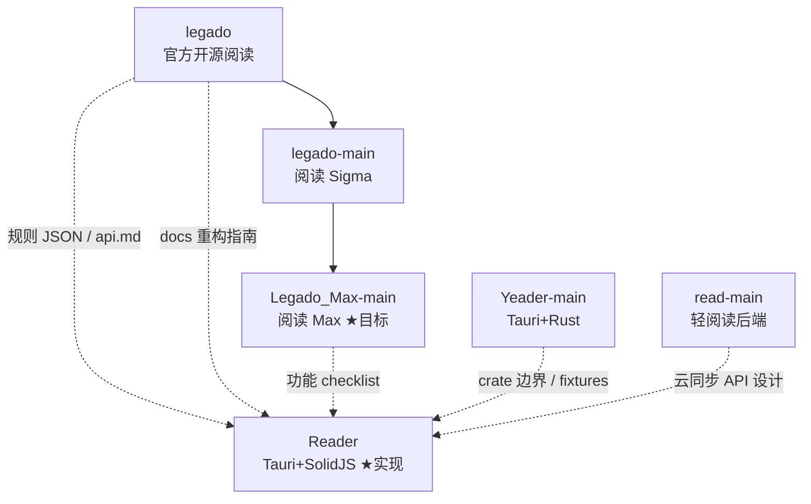

# 六项目对比分析

> 工作区：`D:\Projects\Rust\Reader\`  
> 目标：为 Reader（Tauri 2 + SolidJS）选择参考源，避免抄错层。

## 1. 谱系关系

| 项目 | 路径 | 形态 | 与 Max 关系 |
|------|------|------|-------------|
| legado | `legado/` | Android | 官方基线；含 `docs/` 跨平台分析 |
| legado-main | `legado-main/` | Android | Sigma 线，与 legado 高度同源 |
| **Legado_Max-main** | `Legado_Max-main/` | Android | **功能最全的参考目标** |
| read-main | `read-main/` | JVM 服务端 | 非客户端；借鉴同步与 `book` 模块 |
| Yeader-main | `Yeader-main/` | Tauri + Rust crates | 模块化与 `legado://` 协议参考 |
| **Reader** | `Reader/` | Tauri 2 + SolidJS | **交付产物** |

---

## 2. 各项目技术栈

### 2.1 Legado_Max-main（主参考）

| 层级 | 技术 |
|------|------|
| UI | Android ViewBinding + **部分 Jetpack Compose**（调试等） |
| 架构 | MVVM + Repository + Room |
| 异步 | Kotlin Coroutines + Flow |
| 事件 | LiveEventBus |
| 网络 | OkHttp + Cronet |
| JS 规则 | **Rhino**（`modules/rhino`） |
| 本地书 | **modules/book**（EPUB/UMD）+ app 内 MOBI/PDF |
| 内置 Web | **Vue 3 + Vite + Element Plus + Pinia**（`modules/web`） |
| 局域网服务 | NanoHTTPD + WebSocket（`HttpServer` / `WebSocketServer`） |
| DB | Room `legado.db` **v96** |

关键文档：`Legado_Max-main/Structure/*.md`、`Legado_Max-main/api.md`。

### 2.2 legado / legado-main

与 Max 共享 `io.legado.app` 包结构：`ui/`、`model/`、`data/`、`help/`、`web/`。

| 差异点 | legado | legado-main | Legado_Max |
|--------|--------|-------------|------------|
| 品牌 | Legado 官方 | 阅读 Sigma | 阅读 Max |
| 本地 docs | **14 篇重构文档** | 无 | Structure 架构文 |
| Compose | 无 | 无 | 有 |
| Max 特性 | 无 | 无 | @webjs、调试台、热力图等 |

**可复用**：`model/analyzeRule`、`model/webBook`、`data/entities`、`api.md`、书源 JSON 字段。  
**勿移植**：Activity/Fragment、Rhino 绑定、Cronet 配置。

### 2.3 read-main（轻阅读）

| 层级 | 技术 |
|------|------|
| 框架 | Solon 3 + Kotlin |
| DB | SQLite / MySQL + MyBatis-Plus |
| 书源 | 子工程 `:book`（`WBook`、`AnalyzeUrl`） |
| 特色 | 账号体系、多端进度、WebSocket 调试、`java.qread()` 代理 API |

**可复用**：REST 划分（书架/书源/进度）、WebSocket 调试形态、Docker 部署思路。  
**注意**：服务端 JS 环境与 Legado 安卓 **不完全一致**，不可假设书源零修改即可跑。

### 2.4 Yeader-main

| 层级 | 技术 |
|------|------|
| 壳 | Tauri 2 |
| 核心 | Rust workspace：`yeader-rules`、`yeader-library`、`yeader-protocol`… |
| 前端 | **Vanilla TS**（非 Solid） |
| 测试 | `fixtures/legado/**` |

**可复用**：crate 边界、`legado://import/` 解析、备份目录结构。  
**与 Reader 差异**：Reader 把规则放在 **TS（quickjs + cheerio）**；勿维护双引擎行为 unless 明确分层。

### 2.5 Reader（当前）

| 层级 | 技术 |
|------|------|
| 壳 | Tauri **2.10.x** |
| UI | SolidJS 1.9 + Tailwind **v4** + Kobalte |
| 图标 | 自绘 SVG（**待迁 lucide-solid**） |
| 规则 | TS：`lib/book-source`、`lib/rule-engine`、quickjs-emscripten |
| DB | tauri-plugin-sql / Web 用 sql.js |
| Rust | 配置路径、HTTP 下载、GBK、Boa 登录脚本、Cookie 开窗 |

---

## 3. 应对 Tauri+SolidJS 的参考策略

| 需求 | 第一参考 | 第二参考 | 避免 |
|------|----------|----------|------|
| 功能是否要做 | **Legado_Max README + Structure** | legado 官方行为 | 照搬 Compose/View 代码 |
| 书源字段与规则语义 | legado `BookSource.kt` / Max 同路径 | Yeader fixtures | read-main 专有 API |
| 跨平台分层 | `legado/docs/architecture-analysis.md` | `legado/docs/cross-platform-guide.md` | 把排版放进 Rust |
| Web 管理页字段 | `Legado_Max-main/modules/web` | `api.md` | 引入 Vue 到 Reader |
| Tauri 命令划分 | Yeader `src-tauri` | Reader 现有 `lib.rs` | 整包 Rust 重写业务 |
| 云同步（若做） | read-main controllers | Max WebDAV/备份 | 第一期就上账号服 |

---

## 4. Legado Max 模块 → Reader 映射（总表）

| Max（Android） | Reader 目标位置 | 实现层 |
|----------------|-----------------|--------|
| `ui/main` 书架/发现/订阅/我的 | `pages/bookshelf`、`discover`、占位 subscription | 前端 |
| `ui/book/read` | `pages/reader/*` | 前端（排版 DOM/CSS） |
| `model/webBook` | `lib/book-source/*` | 前端 |
| `model/analyzeRule` | `lib/rule-engine/*` | 前端 |
| `model/localBook` | `lib/local-book/*` | 前端 + epubjs |
| `data/AppDatabase` | `lib/database/*` | 前端 SQL + 插件 |
| `help/book/BookHelp` 缓存 | `lib/database` + fs 插件 | 前端 + 插件 |
| `modules/rhino` | quickjs-emscripten | 前端 |
| `modules/book` EPUB/UMD | epubjs + 待补 umd/mobi | 前端 / 后期 Rust |
| `web/HttpServer` | 可选：内置静态服务或省略 | 插件 / 后期 |
| `service/TTS` | Web Speech API / 平台 TTS 插件 | 前端 → 插件 |
| `help/AppWebDav` | `lib/remote-book/*` | 前端 HTTP |
| `loginCheckJs` + Cookie | `SourceLoginDialog` + Boa/Rust | 混合 |
| Max 调试台 | 待建 `pages/debug/*` | 前端 |

---

## 5. 关键文件索引

### Legado_Max-main

- 应用入口：`app/src/main/java/io/legado/app/App.kt`
- 数据库：`app/.../data/AppDatabase.kt`
- 书源：`app/.../model/webBook/WebBook.kt`
- 规则：`app/.../model/analyzeRule/AnalyzeRule.kt`
- 阅读：`app/.../model/ReadBook.kt`
- 缓存：`app/.../help/book/BookHelp.kt`
- HTTP 服务：`app/.../web/HttpServer.kt`
- API 说明：`api.md`
- 架构：`Structure/架构总结.md` 等

### legado 文档

- `legado/docs/cross-platform-guide.md`
- `legado/docs/architecture-analysis.md`
- `legado/api.md`

### Reader

- 前端入口：`src/App.tsx`
- 书源引擎：`src/lib/book-source/`
- 数据库：`src/lib/database/`
- Rust：`src-tauri/src/lib.rs`

### Yeader

- `Yeader-main/fixtures/legado/`
- `Yeader-main/crates/yeader-protocol/src/lib.rs`
