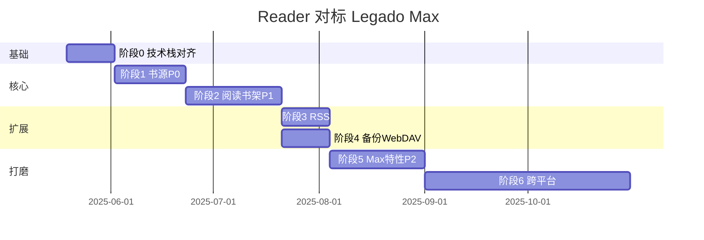

# 实施路线图

将 Reader 对齐 **Legado_Max-main** 的分阶段计划。原则：**前端先行 → Rust 补强 → 插件扩展**。  
功能明细见 [FEATURE_MATRIX.md](./FEATURE_MATRIX.md)，架构见 [ARCHITECTURE.md](./ARCHITECTURE.md)。

---

## 阶段 0：基础对齐（1–2 周）

**目标**：统一技术栈与工程规范，无用户可见大功能。

| 任务 | 产出 | 层 |
|------|------|-----|
| 安装 `lucide-solid`，制定图标映射表 | 替换 `icons.tsx` 高频图标 | 前端 |
| 引入 `@solidjs/router` | 路由与深链骨架 | 前端 |
| 建立 `fixtures/legado/` | 3+ 测试书源、1 备份样例 | 测试 |
| `BookSource` TS 类型与 Max Kotlin diff | `types/book-source.ts` 补字段 | 前端 |
| 移除无效 invoke（如 `greet`） | 设置页不再报错 | 清理 |
| 文档 | README 索引已就绪 | 文档 |

**验收**：`pnpm build` 通过；路由可直达书架/书源/设置；图标统一 lucide。

---

## 阶段 1：书源闭环 P0（2–3 周）

**目标**：达到「可编辑、可调试」的 Legado 兼容。

| 任务 | Max 对照 | 层 |
|------|----------|-----|
| 书源编辑页（全字段表单） | `BookSourceEditActivity` + web `bookSourceEditConfig` | 前端 |
| 书源新建/复制/删除 | 同上 | 前端 |
| 规则调试面板（搜索→详情→目录→正文） | `BookSourceDebugActivity` / WS debug | 前端 |
| loginCheckJs 路径统一 | login 流程 | TS + 现有 Boa |
| 二维码/剪贴板导入 | 扫码 Activity | 前端 + dialog |
| `js-api-compat` 文档 | Rhino API | 文档 |

**验收**：不装 Max，仅在 Reader 内完成：导入样例源 → 编辑规则 → 调试通过 → 搜索加书架。

---

## 阶段 2：阅读与书架增强 P1（3–4 周）

| 任务 | Max 对照 | 层 |
|------|----------|-----|
| 替换规则 CRUD + 阅读生效 | `ReplaceRuleActivity` / ContentProcessor | 前端 |
| 章节缓存 `.nb` | `BookHelp` | 前端 + fs |
| 换源 | 换源 Activity | 前端 |
| 更新目录（单本/批量） | 书架菜单 | 前端 |
| 书签 UI + 阅读内添加 | Bookmark | 前端 |
| 阅读记录页 + 计时写入 | ReadRecord* | 前端 |
| 顶栏「更多」菜单接线 | 书架更多 | 前端 |
| 修 bugs.txt 段评闪烁 | ReadBook 重渲染 | 前端 |
| 侧栏最近阅读（真实数据） | 书架历史 | 前端 |

**验收**：读 100 章离线缓存；替换去广告；书签/记录可查看；换源后目录更新。

---

## 阶段 3：订阅 RSS P1（2 周）

**状态**：核心流程已实现（`pages/rss/`）；待补 WebSocket 调试台与规则订阅完善。

| 任务 | Max 对照 | 层 | 状态 |
|------|----------|-----|------|
| RSS 源列表/编辑/导入 | `RssSourceActivity` | 前端 | ✅ |
| 订阅 Tab 实装 | `RssFragment` | 前端 | ✅ |
| 文章列表与阅读 | `RssReadActivity` | 前端 | ✅ |
| RSS 规则解析 | model/rss | 前端 | 🟡 |
| RSS 调试 WebSocket | `RssSourceDebugActivity` | 前端 | ⬜ |

**验收**：添加 RSS 源 → 拉文章 → 阅读 → 收藏（若 Max 支持）。——**主路径已满足**。

---

## 阶段 4：备份与 WebDAV P1（2 周）

| 任务 | Max 对照 | 层 |
|------|----------|-----|
| Legado zip 备份导入 | `Backup.kt` | 前端 + fs |
| WebDAV 自动同步进度 | `AppWebDav` | 前端 |
| 导出书单/缓存管理 UI | 书架菜单 | 前端 |

**验收**：Max 备份包导入书架；WebDAV 进度双向一致。

---

## 阶段 5：体验与 Max 特性 P2（3–4 周）

| 任务 | 说明 | 层 |
|------|------|-----|
| TTS + HttpTTS 表管理 | 先 Web Speech | 前端 → 插件 |
| 校源 CheckSource | 批量检测 | 前端 |
| MOBI/UMD/PDF 择一 | 评估工作量 | 前端/Rust |
| 双页阅读 | bugs.txt | 前端 |
| 书源 `@webjs` 兼容 | Max 特有 | 前端 |
| 调试台简化版 | DebugTools 子集 | 前端 |
| 存储管理页 | StorageManage | 前端 |

---

## 阶段 6：跨平台与插件 P2–P3（持续）

| 任务 | 层 |
|------|-----|
| Android/iOS 构建流水线 | Tauri mobile |
| 文件 SAF、后台朗读 | 插件 |
| `legado://` 系统协议 | Rust + 插件 |
| 可选：局域网 HTTP 1234 | 插件（低优） |

---

## 里程碑总览

| 里程碑 | 整体完成度（估） | 标志 |
|--------|------------------|------|
| M0 基础 | 45% → 50% | lucide + router + fixtures |
| M1 书源 | 50% → 60% | 编辑+调试 |
| M2 阅读 | 60% → 75% | 缓存/书签/记录/换源 |
| M3 订阅 | 75% → 82% | RSS Tab 可用 |
| M4 同步 | 82% → 88% | Legado 备份互通 |
| M5 体验 | 88% → 93% | TTS/多格式/调试 |
| M6 移动 | 93% → 98% | 双端发布 |

---

## 每周检查清单

- [ ] FEATURE_MATRIX 状态是否更新  
- [ ] 新增书源字段是否同步 `types/book-source.ts`  
- [ ] 是否误把 UI/排版逻辑写入 `src-tauri`  
- [ ] 新功能是否走 `lib/platform` 抽象  
- [ ] 至少 1 个 fixture 自动化测试通过  

---

## 与 legado/docs 分阶段文档的关系

`legado/需求.txt` 要求对官方 legado 写详尽分阶段文档；本 ROADMAP **专注 Reader 交付**，不替代 `legado/docs/first.md` 等。  
实施时：

- **行为语义** → 查 Max / legado 源码  
- **跨平台写法** → 查 `legado/docs/cross-platform-guide.md`  
- **排期** → 以本文为准  
