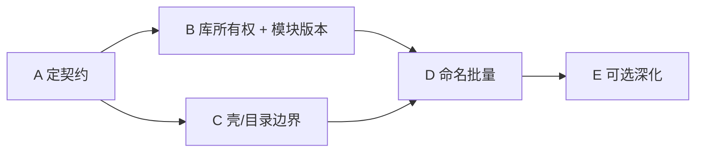

# 主壳 + 子模块架构迁移指南

> 目标：从「Legado 单体阅读器」演进为 **MediaBox 主壳 + 独立子模块**（阅读 / 音频 / 视频 / 订阅…），在命名、目录与数据库上切断技术债增长。  
> 本文回答两件事：**从哪里入手**，以及 **数据库该迁成什么结构**。  
> 与既有 [DATABASE.md](./DATABASE.md)（Legado 兼容策略）、[ARCHITECTURE.md](./ARCHITECTURE.md)（分层）互补；冲突时以本文「壳模块」视角为准。

---

## 0. 一句话结论

| 问题 | 答案 |
|------|------|
| 从哪里入手？ | **先定命名契约与兼容层 → 再按模块拆表/加前缀迁移 → 最后清代码别名**。 |
| `media_groups` 拆不拆？ | **拆**。还原阅读侧 `reader_book_groups`（语义=原 Legado `book_groups`），音频侧独立 `audio_groups`；取消用 `domain` 混装的枢纽表。 |
| 表名要不要加模块前缀？ | **要**。目标态一律 `{module}_*`（`reader_` / `audio_` / `video_` / `shell_` / `sub_`）；Legado 互导靠**导入导出适配器**（必要时过渡期 VIEW），不靠物理表继续用无前缀原名。 |
| 模块叫 music/tv 还是 audio/video？ | **目标用 `audio` / `video`**。`music` 无法覆盖未来播客/有声/其它音频；`tv` 无法覆盖未来非「影视站」类视频能力。壳 Tab、目录、表前缀一并对齐；现状 `music`/`tv` 仅作过渡别名。 |
| 库文件？ | 仍推荐单文件 `mediabox.db` + `schema_modules` 分版本；不立刻多文件 ATTACH。 |

> 修订说明：  
> 1. 早期草案曾倾向「阅读表保持 Legado 原名 + `media_groups` 整合」→ 已改为 **拆分 + 全量模块前缀**。  
> 2. 曾短期写过「`audio_*` 改名为 `music_*`」→ **撤回**；以更宽的 **`audio` / `video` 模块名** 为准，表前缀分别为 `audio_` / `video_`。

---

## 1. 现状诊断（为何会越来越难改）

### 1.1 产品与工程身份已经分裂

| 层 | 当前值 | 问题 |
|----|--------|------|
| 窗口 / 展示名 | `MediaBox`（`tauri.conf.json`、`APP_DISPLAY_NAME`） | 用户侧已是 MediaBox |
| npm / Cargo | `reader` / `reader_lib` | 工程仍叫 Reader |
| Bundle id | `com.zkingz.reader` | 与展示品牌不一致 |
| 数据文件 | `reader.db` | 文档多处仍写 `legado.db` |
| 代码注释 / docs | 大量「对应 legado 的 AppDatabase」 | 新模块被当成「往 Legado 库里加表」 |

壳层其实已经有雏形：`SHELL_MODULES` 目标 = `reader | audio | video | subscribe`（现状代码仍为 music/tv，待改），`PageType` 也在做 legacy alias。缺口是：**数据库与源码目录仍按「一个 Legado 应用」组织**。

### 1.2 模块来源与当前落点

```
legados-main / Legado Max  ──►  阅读（books / book_sources / chapters / rss* / …）
lx-music-desktop-master   ──►  音频域起点（现状 audio_* / music_* / domain=music；目标统一 audio_*）
TV-fongmi                 ──►  视频域起点（现状 tv_*；目标 video_*）
Folo（规划）              ──►  订阅（壳 Tab 已有，持久化域已有占位）
```

代码侧大致路径：

| 模块 | 业务代码 | 持久化 | UI |
|------|----------|--------|-----|
| 壳 | `lib/shell`、`lib/modules`、`components/shell` | `persistence/domains/shell-tabs`、主题等 | 导航 / 侧栏 / 全局播放条 |
| 阅读 | `lib/book-*`、`lib/rss*`、`pages/reader`… | `lib/database/{books,chapters,…}` | `pages/*`、`components/reader` |
| 音频 | `lib/media/audio/**` | `audio-library.ts`、`music-playback-state.ts`（待改名） | 现状 `pages/music` → 目标 audio |
| 视频 | `lib/media/tv/**`（待迁 video） | `migration-v108-tv`、`tv/db/tv-dao` | 现状 `pages/tv` → 目标 video |
| 订阅 | 规划中 | `subscribe-session` | `pages/subscribe` |

### 1.3 数据库现状（单库混装）

- 文件：`reader.db`（Tauri：`{dataDir}/reader.db`；Web：IndexedDB 同名）。
- 版本：自定义 `schema_version`，当前链约 **v1 → v96（对齐 Legado）→ v97–99（章节缓存）→ v100（主题）→ v101–109（音乐 / 分组 / 影视 / 播放态）**。
- **部分 `media_*` 表并非 MediaBox 凭空新建**，而是从 Legado 原表**改名 + 扩列**而来（典型：`book_groups` → `media_groups`，见 §1.3.1）。
- 阅读核心表（`books` / `book_sources` / …）仍保持 Legado 原名；音频 / 视频另有 `audio_*` / `tv_*`（目标 `video_*`）前缀表。
- 以上全部仍**共用同一迁移流水线与同一所有权模型**。

```
┌──────────────────── reader.db（现状）────────────────────┐
│  schema_version（全局一条链）                              │
│  ── 阅读 / Legado 原名 ──                                 │
│  books · chapters · book_sources · bookmarks · rss* …     │
│  ── Legado 派生 → 壳共享（media_*）──                     │
│  media_groups ← book_groups                               │
│  media_group_items / media_preview_items（MediaBox 新增） │
│  theme_presets · cookies …                                │
│  ── 音乐 ──                                               │
│  audio_tracks · audio_playlists · music_playback_state …  │
│  ── 视频（现状 tv_*）──                                   │
│  tv_*（目标改名为 video_*）                                 │
└───────────────────────────────────────────────────────────┘
```

**技术债本质**：新模块每加一张表，都要挂到「Legado 风格全局 version++」上；备份、导入、测试都默认「整库 = 阅读库」；同时 `media_*` 名称掩盖了其 **Legado 血统**，导入/导出时容易漏做 `book_groups` ↔ `media_groups` 映射。

### 1.3.1 Legado 原库 → MediaBox：`media_*` 谱系（重要）

对照上游 `legados-main`：`BookGroup` → 表名 `book_groups`（见 `app/.../entities/BookGroup.kt`）。

#### Legado 原始 `book_groups`（须兼容）

| 字段 | 说明 |
|------|------|
| `groupId` | 主键；系统保留 ID 为负数，用户自定义分组为 **正数且作位掩码** |
| `groupName` / `cover` / `order` | 名称、封面、排序 |
| `enableRefresh` / `show` / `bookSort` / `onlyUpdateRead` | 刷新、是否显示、组内排序、只更新已读 |

Legado 内置 `groupId`（MediaBox 仍沿用同一数值语义）：

| ID | Legado 常量 | 含义 | MediaBox 现状 |
|----|-------------|------|----------------|
| -100 | `IdRoot` | 根 | 保留 |
| -1 | `IdAll` | 全部 | 保留，`domain=shelf` |
| -2 | `IdLocal` | 本地 | 保留 |
| -3 | `IdAudio` | 音频（听书类型筛选） | **v104 删除行**；常量标 `@deprecated`，仅备份解析 |
| -4 | `IdNetNone` | 网络未分组 | 保留 |
| -5 | `IdLocalNone` | 本地未分组 | 保留 |
| -6 | `IdVideo` | 视频 | **v104 删除行**；同 deprecated |
| -11 | `IdError` | 更新失败 | 保留 |

书籍归属在 Legado 中主要靠 `books."group"` **位标志**与正数 `groupId` 做 `&` 匹配（见 `BookDao`），**不是**独立成员表。

#### MediaBox 演进（v104–v107）

```text
legados-main book_groups
        │
        │  RENAME TABLE（v104）
        ▼
 media_groups
   + domain   TEXT  ('shelf' | 'music' | 'shared')   ← MediaBox 扩列
   + listId   TEXT  （音乐歌单 ID 等）
   + source   TEXT
        │
        ├─ 删除 IdAudio(-3) / IdVideo(-6) 行（听书/影视已独立模块，不再用书架伪分组）
        ├─ 新增 Favorite(-7) / Preview(-8)（shared）
        └─ 挂入 music 内置/用户列表（MusicDefault=-20 …）

 media_group_items（v104 新建，非 Legado 表）
   ← 承接 books."group" 位标志成员（v105）
   ← 承接 audio_playlist_items（v105 后变为视图）

 media_preview_items（v104 新建，非 Legado 表）
```

| 对象 | 血统 | 说明 |
|------|------|------|
| `media_groups` | **Legado 派生** | = 原 `book_groups` 改名 + 扩列；导入官方库时必须映射 |
| `media_group_items` | MediaBox 新建 | 替代 Legado「`books.group` 位掩码」与音乐 playlist 成员表 |
| `media_preview_items` | MediaBox 新建 | 试读/试听/试看缓存条目 |
| `BookGroup` / `MediaGroup` 类型 | 同一实体双名 | `types/book-group.ts` 仍保留 Legado 字段名（`groupId` 驼峰等） |

**设计含义（现状 → 目标）**：

- **现状**：`media_groups` 是在 Legado `book_groups` 上长出的跨模块枢纽（带 `domain`）。  
- **目标（已拍板，见 §3.0）**：**拆分**为 `reader_book_groups` + `audio_groups` + `shell_*`，并为全部业务表加模块前缀；Legado 互导走适配器，不再依赖「物理表保持无前缀原名」或「一张 media_groups 混域」。

### 1.4 命名债清单（按痛感排序）

1. **产品名三套并行**：MediaBox（UI）/ Reader（仓库与包）/ legado（注释与旧文档）。
2. **`book_*` vs `media_*` 半迁移**：表已改名，类型/文件仍双轨（`BookGroup`↔`MediaGroup`，`book-groups.ts`↔`media-groups.ts`）；**且掩盖 Legado 血统**。
3. **PageType 大量 `@deprecated` alias**（`bookshelf`/`media`/`scout`…）——壳已切，调用点未清干净。
4. **文档滞后**：旧 ROADMAP 等仍以「对标 Legado Max 单体」为轴；壳文档需持续同步 `audio`/`video` 命名。

---

## 2. 从哪里入手（推荐顺序）

原则：**先契约后机械；先所有权后改名；一次只动一类债。**

### 阶段 A：定契约（1–3 天，不改运行时行为）

产出本文落地所需的「硬约定」：

1. **产品名**：对外 `MediaBox`；仓库目录可暂留 `Reader/`，但文档与新代码统一写 MediaBox。
2. **模块 ID**（已存在，冻结）：`shell` | `reader` | `audio` | `video` | `subscribe`（现状 music/tv 为过渡别名）。
3. **数据所有权**：每张表只属于一个模块（见 §3）；跨模块只读通过壳 API，禁止业务互相 `JOIN` 对方核心表。
4. **兼容边界**：
   - 阅读模块：**必须**能导入 Legado / Max 的 `legado.db` 与备份 zip 中共有表；其中 **`book_groups` 映射为 `reader_book_groups`**（目标态；过渡期见 §3）。
   - 音频 / 视频：**不追求**与 Android 原版 DB 文件二进制互通；只保证 MediaBox 自身备份可恢复。
   - **不得**因「表已叫 media_*」而在导入时忽略 Legado 分组数据，或反过来用整表覆盖清掉音频域（现 `domain=music`）行。

验收：团队对「这张表归谁」无争议；在 `docs` 挂一张所有权表（§3.3）。

### 阶段 B：数据库结构化迁移（高优先级）

按 §3.4 四步走（可跨多个迭代）：

1. **M1**：`schema_modules` + `reader.db`→`mediabox.db`。
2. **M2**：拆 `media_groups` → `reader_book_groups` + `audio_groups` + shell 收藏/预览。
3. **M3**：阅读表加 `reader_` 前缀 + Legado 导入导出适配器。
4. **M4**：统一收敛为 `audio_*`（含 `music_playback_state`→`audio_playback_state`），`tv_*`→`video_*`，壳表加 `shell_`，清理旧名。

验收：打开 `mediabox.db` 可按前缀一眼区分模块；Legado 备份仍可导入阅读域。

### 阶段 C：壳层与模块边界清理（与 B 并行，持续）

1. 导航只保留壳 Tab：`reader` / `audio` / `video` / `subscribe` / `settings`（过渡期可 alias music→audio、tv→video）；清除业务对 deprecated `PageType` 的直接依赖。
2. `lib/database/*` 按模块分子目录（物理拆分，API 可先 re-export）：
   ```
   lib/database/
     core/          # 连接、迁移调度、mediabox.db、Legado 适配器
     shell/         # shell_*
     reader/        # reader_*（含 reader_book_groups）
     audio/         # audio_*
     video/         # video_*
   ```
3. 业务禁止 `import` 其它模块的 DAO；跨模块走 `lib/modules` 或壳事件。

### 阶段 D：工程命名整理（与 M3/M4 窗口并行）

| 优先级 | 项 | 建议 |
|--------|----|------|
| P0 | DB 文件 / 表前缀 | 见 §3.4 M1–M4 |
| P0 | Legado 适配器 | `lib/database/core/legado-table-map.ts` |
| P1 | 类型别名清理 | `MediaGroup` 拆为 `ReaderBookGroup` / `MusicGroup` |
| P1 | 包名 | npm `mediabox`；identifier 评估后再改 |
| P2 | 仓库目录 | `Reader/` → `MediaBox/`（可最后） |
| P2 | 协议 | 保留 `legado://`；可选 `mediabox://` |

### 阶段 E：可选深化（有明确收益再做）

- 阅读正文缓存完全出库（文件制，对齐 Max）——见旧 [DATABASE.md](./DATABASE.md) §4。
- 订阅（Folo）独立域表。
- 多进程 / 插件化加载模块（当前不需要）。



**不要从这里开始**：全库第三范式重写、同步维护 Room 96、一次改完所有 `legado` 字符串、为音乐/影视复刻 Android 原版表结构。

---

## 3. 数据库目标结构

### 3.0 两项关键决策（已拍板）

#### 决策 1：`media_groups` — 拆成模块表，不再整合

| 方案 | 做法 | 结论 |
|------|------|------|
| 保持 `media_groups` + `domain` | 一张表混 shelf/music/shared | **否决**（所有权模糊、导入易误伤音频行、与「主壳+子模块」不一致） |
| **拆分** | 阅读 `reader_book_groups` + 音频 `audio_groups` + 壳共享表 | **采用** |

| 当前 | 目标表 | 模块 | 说明 |
|------|--------|------|------|
| `media_groups` WHERE domain=shelf（及系统负 ID） | `reader_book_groups` | reader | 列对齐 Legado `book_groups`；物理表归阅读模块 |
| `media_groups` WHERE domain=music | `audio_groups` | audio | 播放列表/试听/最近/用户列表（不限于「音乐」） |
| `media_groups` WHERE domain=shared（Favorite/Preview） | `shell_favorites` 等 | shell | 跨模块入口，不塞回 book/audio |
| `media_group_items`（book） | `reader_book_group_items` | reader | 替代 `books."group"` 位掩码成员 |
| `media_group_items`（track） | `audio_group_items` | audio | 替代 playlist items 视图 |
| `media_preview_items` | `shell_preview_items` | shell | 试读/试听/试看 |

血统：`reader_book_groups` 仍是 Legado `book_groups` 直系后代（加模块前缀）。映射：

```text
Legado book_groups  ↔  reader_book_groups
Legado books."group" bits  →  reader_book_group_items
```

#### 决策 2：命名 — 全量模块前缀（清晰优先）

| 方案 | 做法 | 结论 |
|------|------|------|
| 保持简洁原名（`books`/`chapters`…） | 阅读像 Legado，其它各自前缀 | **否决为长期目标** |
| **全量 `{module}_` 前缀** | 凡业务表均带模块前缀 | **采用** |

| 前缀 | 模块 ID | 中文域 | 示例 |
|------|---------|--------|------|
| `reader_` | `reader` | 阅读 | `reader_books`、`reader_book_groups` |
| `audio_` | `audio` | 音频（含音乐，不限于音乐） | `audio_tracks`、`audio_groups`、`audio_playback_state` |
| `video_` | `video` | 视频（含影视站，不限于 TV） | `video_config`、`video_history`… |
| `shell_` | `shell` | 壳 | `shell_theme_presets`、`shell_cookies`、`shell_favorites` |
| `sub_` | `subscribe` | 订阅 | 预留 |
| `schema_` | meta | 元数据 | `schema_modules` |

#### 决策 3：模块名 — `audio` / `video`（已拍板）

| 现状（代码/壳 Tab） | 目标 | 原因 |
|---------------------|------|------|
| `music` | **`audio`** | 后续会引入非「曲库音乐」的音频能力（播客、有声等）；`music` 过窄 |
| `tv` | **`video`** | 后续视频不限于 FongMi 式「影视站」；`tv` 过窄 |

连带约定：

- 表前缀、`lib/database/{audio,video}`、壳模块 ID、文案「音频」「视频」与模块 ID 对齐。  
- 上游仍可写 lx-music / TV-fongmi，但**产品模块名不再叫 music/tv**。  
- 过渡：`music→audio`、`tv→video` 路由/PageType alias。  
- **撤回**「`audio_*`→`music_*`」；改为保留 `audio_*`，并把 `music_playback_state` 等迁入 `audio_*`，`tv_*`→`video_*`。

**Legado 兼容靠适配器，不靠物理表沿用无前缀名：**

1. 导入：官方 `books`/`book_groups`/… → `reader_*`  
2. 导出：`reader_*` → 无前缀 Legado 表名  
3. 过渡期可选：`VIEW books AS SELECT * FROM reader_books`（稳定后删除）  
4. DAO 只认带前缀表名  

### 3.1 选型：单库 + 模块前缀表

| 方案 | 结论 |
|------|------|
| **A. 单库 `mediabox.db` + 模块前缀表** | **推荐** |
| B. 多文件 ATTACH | 暂缓 |
| C. 一张 `media_items` 吞并书/歌/剧 | **否决** |
| D. 继续 `media_groups` 混域 | **否决** |

```
{dataDir}/mediabox.db

┌────────────────────── mediabox.db ──────────────────────┐
│  schema_modules / schema_version                         │
│  shell_*     theme / cookies / favorites / preview …     │
│  reader_*    books / book_groups / chapters / sources …  │
│  audio_*     tracks / groups / group_items / playback …  │
│  video_*     config / history / keep / site_pref         │
│  sub_*       （预留）                                     │
└──────────────────────────────────────────────────────────┘
```

### 3.2 命名与重命名对照（现状 → 目标）

#### 阅读

| 现状 | 目标 |
|------|------|
| `books` | `reader_books` |
| `book_groups` / `media_groups`(shelf) | `reader_book_groups` |
| `chapters` | `reader_chapters` |
| `book_sources` | `reader_book_sources` |
| `bookmarks` | `reader_bookmarks` |
| `replace_rules` | `reader_replace_rules` |
| `searchBooks` | `reader_search_books` |
| `search_keywords` | `reader_search_keywords` |
| `rssSources` 等 | `reader_rss_sources` 等 |
| `readRecord*` | `reader_read_record*` |
| `chapter_cache` | `reader_chapter_cache` |
| `httpTTS` / `txtTocRules` / … | `reader_http_tts` / `reader_txt_toc_rules` / … |

#### 分组拆分与音频

| 现状 | 目标 |
|------|------|
| `media_groups` (music) | `audio_groups` |
| `media_group_items` (track) | `audio_group_items` |
| `audio_tracks` | `audio_tracks`（保持） |
| `audio_playlists` | 迁移进 `audio_groups` 后废弃 |
| `audio_playlist_items`（视图） | 删除；改查 `audio_group_items` |
| `audio_*` 其余 | 保持 `audio_*` |
| `music_playback_state` | `audio_playback_state` |

#### 视频（`tv_*` → `video_*`）

| 现状 | 目标 |
|------|------|
| `tv_config` | `video_config` |
| `tv_history` | `video_history` |
| `tv_keep` | `video_keep` |
| `tv_site_pref` | `video_site_pref` |
| 其它 `tv_*` | `video_*`（同语义改前缀） |

#### 壳

| 现状 | 目标 |
|------|------|
| `media_groups` (shared) | `shell_favorites` 等 |
| `media_preview_items` | `shell_preview_items` |
| `theme_presets` | `shell_theme_presets` |
| `cookies` / `caches` / `servers` | `shell_cookies` / `shell_caches` / `shell_servers` |

列名：表名加前缀；**列名尽量保留 Legado 驼峰**（`bookUrl`、`groupId`），降低字段映射成本。

### 3.3 表所有权（目标态）

| 前缀 | 血统 | 归属 |
|------|------|------|
| `reader_*` | Legado | reader |
| `audio_*` | 音频域（含 lx-music 曲库及未来播客/有声等） | audio |
| `video_*` | 视频域（含 FongMi 点播/直播及未来其它视频能力） | video |
| `shell_*` | 跨模块 | shell |
| `sub_*` | 预留 | subscribe |
| `schema_*` | MediaBox | meta |

迁移完成后 **DROP** 运行时表 `media_groups` / `media_group_items`。

### 3.4 迁移步骤（M1–M4）

```sql
CREATE TABLE IF NOT EXISTS schema_modules (
  module TEXT PRIMARY KEY,
  version INTEGER NOT NULL
);
```

| 步骤 | 内容 | 风险 |
|------|------|------|
| **M1** | `schema_modules`；`reader.db`→`mediabox.db` | 低 |
| **M2** | 拆 `media_groups` / items → reader + audio + shell；删 domain 模型 | 中 |
| **M3** | 阅读表加 `reader_` + 蛇形个别表；上线 Legado 适配器；可选兼容 VIEW | 中高 |
| **M4** | 收敛 `audio_*` + `tv_*`→`video_*`；壳表加 `shell_`；清理旧名与 VIEW | 中 |

顺序：迁移脚本 + 适配器测试 → 改 DAO → DROP 旧表。

### 3.5 分组模型（拆分后）

```text
Legado:   book_groups + books."group"(bitmask)
目标:     reader_book_groups + reader_book_group_items
          audio_groups + audio_group_items
          shell_favorites / shell_preview_items
```

| 模块 | 分组表 | 成员表 | 系统 ID |
|------|--------|--------|---------|
| reader | `reader_book_groups` | `reader_book_group_items` | 沿用 `-1/-2/-4/-5/-11`；不使用 `-3/-6` 行 |
| audio | `audio_groups` | `audio_group_items` | 保持现有 Music*/Audio* 负 ID（少洗数据）；常量可改名 Audio* |
| shell | `shell_favorites` 等 | — | Favorite/Preview 独立 |

`reader_books."group"` 可保留作导入兼容；运行时以 items 为准。

### 3.6 备份 / 导入

| 来源 | 策略 |
|------|------|
| Legado / Max | 适配器 → 仅 `reader_*`；不触碰 audio/video/shell 业务数据 |
| 旧 MediaBox（`media_groups`） | M2 按 `domain` 拆分后 DROP |
| 导出 Legado zip | `reader_*` → 无前缀；`reader_book_groups`→`book_groups` |
| MediaBox 自有备份 | 按模块前缀分条目 |

```text
for each legado_table:
  target = map_to_reader_prefixed(legado_table)
  upsert(source, target)
expand bits → reader_book_group_items
# never wipe audio_* / video_*
```

### 3.7 否决项

1. 统一 `media_items` 大表。  
2. 复刻上游 Android 原表名当物理表。  
3. 全局 `schema_version` 无限线性增长。  
4. 在 `reader_books` 塞歌曲/剧集字段。  
5. 复活 IdAudio/IdVideo 书架行。  
6. **长期保留**无前缀业务表或 `media_groups` 混域。  
7. 无适配器/测试就改名。

---

## 4. 代码与工程命名路线图

### 4.1 近期

| 对象 | 当前 | 目标 |
|------|------|------|
| DB 文件 | `reader.db` | `mediabox.db` |
| 业务表 | 混名 / `media_*` | `{module}_*`（§3.2） |
| `lib/database` | 扁平 | `core/shell/reader/audio/video` |
| Legado 互导 | 零散 | 统一适配器 |

### 4.2 中期

| 对象 | 建议 |
|------|------|
| npm `name` | `mediabox` |
| `identifier` | 评估 `com.zkingz.mediabox` |
| 类型 | `ReaderBookGroup` / `MusicGroup`；淘汰 `MediaGroup` 混用 |
| 深链 | `legado://` 保留为阅读兼容协议 |

### 4.3 原则

- 先适配器与迁移，再改 DAO，最后 DROP。  
- 一次 PR 只推进 M1–M4 中的一步。  
- 同步更新 `examples/main.sql` 与导入测试。

---

## 5. 近期任务清单

1. 冻结契约：§3.0 两条决策写入评审结论。  
2. 实现 `schema_modules` + `mediabox.db` 改名（M1）。  
3. 编写 `legado-table-map`（无前缀 ↔ `reader_*`）与夹具测试。  
4. 实施 M2：拆 `media_groups`（书架 / 歌单回归测）。  
5. 实施 M3：阅读表加前缀；打开导入导出走适配器。  
6. 实施 M4：收敛 `audio_*`、`tv_*`→`video_*`、`shell_*`，清理 `media_*` / 旧 music 命名。  
7. Code review：拒绝无前缀新表、拒绝再往 `media_groups` 加 domain。

---

## 6. 与旧文档的关系

| 文档 | 角色 |
|------|------|
| [DATABASE.md](./DATABASE.md) | 阅读域 ↔ Legado 字段/兼容细节；表名以本文目标态为准 |
| [ARCHITECTURE.md](./ARCHITECTURE.md) | 分层仍有效 |
| [ROADMAP.md](./ROADMAP.md) / [LEGADO_MAX_MIGRATION.md](./LEGADO_MAX_MIGRATION.md) | reader 功能路线图 |
| **本文** | 主壳 + 数据库结构总纲（拆分组、模块前缀、`audio`/`video` 更名） |

---

## 7. 决策摘要

```text
目标：MediaBox 主壳 + reader/audio/video/subscribe
库文件：mediabox.db + schema_modules
分组：拆 media_groups → reader_book_groups + audio_groups + shell_*
命名：全量前缀 reader_/audio_/video_/shell_/sub_
模块更名：music→audio，tv→video（语义加宽；现状 Tab 作 alias）
表收敛：保留 audio_*；music_playback_state→audio_playback_state；tv_*→video_*
Legado：适配器映射，不要求物理表保持无前缀原名
步骤：M1 元数据 → M2 拆组 → M3 reader_ 前缀 → M4 audio_/video_/shell_ 收尾
否决：media_groups 混域长期保留、media_items 大表、无适配器改名、再把 audio 窄化为 music
```

---

## 8. 参考路径

| 路径 | 用途 |
|------|------|
| `src/lib/modules/module-registry.ts` | 壳模块 ID |
| `src/lib/database/migration-v104-media-groups.ts` | 现状：`book_groups`→`media_groups`（待 M2 再拆） |
| `src/lib/database/migration-v105-mediabox.ts` | 现状：items 统一（待按模块拆） |
| `src/types/book-group.ts` | 分组 ID 常量 |
| `src/lib/platform/database.ts` | `DATABASE_NAME` |
| 上游 | `legados-main/.../BookGroup.kt` |