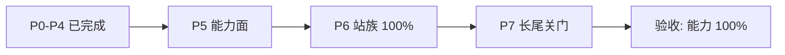

# Reader yt-dlp 移植 vs 上游能力差异

对照路径：

- Reader：`src/lib/download/ytdlp`
- 上游：`Download/yt-dlp-master`

基准文档日期：2026-08-05  
状态刷新：2026-08-08（**P0–P5 能力面已落地**；规划 **P6–P7 → 站族/长尾 100%**）  
侧重架构与能力面，非逐站冒烟。

交互版：[reader-ytdlp-vs-upstream-gaps.canvas.tsx](file:///C:/Users/ZKingZ/.cursor/projects/d-Projects/canvases/reader-ytdlp-vs-upstream-gaps.canvas.tsx)

---

## 最终验收标准：**能力 100%**

| 原则 | 说明 |
|------|------|
| **关门条件** | 相对上游 yt-dlp，用户可见的提取 / 下载 / 协议 / 后处理 / 编排选项 / Utils·Cookie·网络能力达到 **100%**（允许实现路径不同，如 Gopeed/ffmpeg 代理 HttpFD） |
| **极少 OUT** | 仅不做需交互的账号登录类能力，例如：**密码登录**、**手机验证码登录**、需人工的短信/邮箱 2FA 等。Cookie 导入 / 浏览器 Cookie / 已登录 session **必须做** |
| **非差距项** | 上游本身也不支持的（如 Netflix DRM）不计入缺口；CLI/插件/自更新由 App UI/发版**等价覆盖**，不算能力缺失 |
| **HAND 注册** | className 100% 只是起点，行为面须另达 100% |

| 层 | 现状（估） | **验收目标** |
|----|------------|--------------|
| YoutubeDL 编排 | **100%** | **100%** |
| IE common | **100%** | **100%** |
| 协议 / 下载器 | **100%** | **100%** |
| 后处理 | **100%** | **100%** |
| Utils / 网络 | **100%** | **100%** |
| IE className 注册 | **100%** | 100%（维持） |
| 站族行为（相对上游能力） | 部分 | **100%**（除微 OUT） |

---

## 当前判断

P0–P4 已补齐骨架与多项深度；距离验收仍有明显差距。下一阶段 **P5→P6→P7** 以 **100%** 为唯一关门标准，微 OUT 清单白名单化、不可随意扩大。

---

## 各层完整度（粗估）

| 层 | 约完整度 | 备注 |
|----|----------|------|
| YoutubeDL 编排 | **100%** | `_match_entry` · ranges×formats · simulate/list* · cookiesfrombrowser（Firefox/Win Chromium）· writelink · clean_infojson · FD 下传 · section 裁剪 |
| IE common 方法 | **100%** | XML/SMIL/MPD periods·SegmentTemplate · parse m3u8 · XSPF · embeds · `_get_comments`/`_mark_watched`/`_download_xml*` 钩子 |
| 协议 / 下载器 | **100%** | ISM PIFF · live_chat JSONL · rtmpe/rtmpt(rtmpdump) · bunny ping · soopvod 别名 · External axel/httpie · HLS→ffmpeg 回退 |
| 后处理行为 | **100%** | Convertor/Remuxer/Subs·Thumb · Fixup* · ModifyChapters · MetadataParser · engine-bridge 接线 `runPostProcessors` |
| Utils 面 | **100%** | extras/paging/traversal · jsinterp int32/toString · AES ECB/CTR · webvtt parse_fragment · JA3 站表扩展 · per-request impersonate；cookiesfrombrowser 已在编排层 |
| IE 注册覆盖 | 100% | className 100%；Generic RSS/XSPF |

---

## 架构对照

| 层 | Reader | 上游 yt-dlp | 差距 |
|----|--------|-------------|------|
| 产品路径 | `extract_info(false)` → engine-bridge 落盘 | YoutubeDL 内建 FileDownloader 全家桶 | 路径不同；**能力须齐** |
| 提取器注册 | HAND_OVERRIDES ~2034；generated 被跳过 | `_extractors.py` ~1751 IE | 对齐 |
| 提取深度 | 主路径可用；中位 hand ~81 LOC | 全量站点逻辑 + 长尾细节 | 部分 → 须 100% |
| 下载编排 | Gopeed + ffmpeg + hls/f4m-native + External/专用 FD + WS | 17 个 FD 模块 | 部分 → 须 100% |
| JS 运行时 | YouTube ejs/sig + 通用 jsinterp 子集 | jsinterp.py + jsc 生态 | 部分 → 须 100% |
| CLI / 插件 / 自更新 | App UI / 随版发版 | options / plugins / update | 产品等价，**非能力 OUT** |

### 数据流（Reader）

1. `DownloadService.probe`
2. `YoutubeDL.extract_info(url, false)`
3. `process_ie_result` / 格式选择 / archive / match_filter / `prepare_filename`
4. `startYtdlpEngineTask`（engine-bridge）
5. Gopeed · ffmpeg · hls/f4m-native · ExternalFD · special-protocols · **websocket_frag**

> `download=true` 仅 `processing`；不伪造成功（除非 `allow_stub_download`）。

---

## 下载器映射

| 上游 FD | Reader | 说明 |
|---------|--------|------|
| HttpFD | 外置代理 | Gopeed；续传/分块对齐 ✓ |
| HlsFD | 对齐 | AES-128 原生；SAMPLE-AES/失败 → ffmpeg |
| DashSegmentsFD | 外置代理 | ffmpeg DASH / fragments ✓ |
| F4mFD | 对齐 | f4m-native mdat + FLV header |
| IsmFD | 对齐 | `ism-native` PIFF + `_download_params` |
| RtmpFD / rtmp_ffmpeg | opt-in | ffmpeg 与/或 rtmpdump |
| rtmpe / rtmpt | opt-in | `allowRtmpDump` + rtmpdump |
| WebSocketFragmentFD | 对齐 | `media_convert_fetch_websocket_frag` |
| ExternalFD | 对齐 | aria2c/curl/wget/**axel/httpie**/rtmpdump |
| Niconico/FC2/Bunny/Mhtml/Soop | 对齐 | special-protocols（ping/heartbeat/MHTML/别名） |
| YoutubeLiveChat | 对齐 | `youtube-live-chat.ts` → JSONL |

---

## 后处理

| 上游 PP | Reader | 说明 |
|---------|--------|------|
| FFmpegMerger / ExtractAudio / Embed* | 对齐 | remux → Tauri；成片后 `runPostProcessors` |
| SponsorBlock + 物理裁剪 | 对齐 | API + cut；与 ModifyChapters 协作 |
| Split Chapters / Concat / WriteInfoJson | 对齐 | 物理 split / merge / infojson |
| EmbedThumbnail / FixupM3u8·M4a | 对齐 | + Stretched/Timestamp/Duration/DuplicateMoov |
| VideoConvertor / Remuxer / Subs·Thumb Convertor | 对齐 | `convertors.ts` + remux ops |
| ModifyChapters（真改章节） | 对齐 | `modify-chapters.ts`（不再误映射 Split） |
| MetadataParser / MetadataFromField | 对齐 | `metadataparser.ts` |
| XAttr / MoveFiles / Exec | 对齐 | 桌面路径；Windows xattr 不可用与上游一致 |

---

## 高价值站点深度

**HAND 100% 含义：** 类名有手写 TS 并注册；行为面须另达 100%。中位 hand ~81 LOC。

| 站点 | 深度 | 说明 |
|------|------|------|
| YouTube 单视频 | 部分 | nsig/ejs/po_token/age-gate；SABR 等 → **P6 冲 100%** |
| YouTube Tab / Playlist | 部分 | 三 tab + continuation；playlists/posts/Music → **P6** |
| Bilibili | 部分 | dolby/flac/弹幕/ugc；**Cookie/session 登录友好**；不做密码/短信验证码 |
| TikTok / Douyin | 部分 | 网页/aweme；app 签/列表 → **P6** |
| Twitch / Twitter / Instagram | 部分 | 主路径可用；深度 → **P6**（IG 依赖 cookie，不做密码登录） |
| Vimeo / SoundCloud / Generic | 部分 | → **P6–P7 行为 100%** |
| Netflix / DRM | N/A | 上游亦不做；不计入缺口 |

---

## 下一步：P5–P7（冲 100%）

### 冲刺原则

1. **验收唯一标准 = 能力 100%**（微 OUT 白名单外全部齐）。
2. **先 P5 能力面，再 P6 站族**，最后 P7 长尾关门。
3. **微 OUT 不可扩大**；新增「不做」须显式写入白名单并说明原因。
4. 验收用金样 URL extract + 落盘；辅以 method-surface / FD·PP 矩阵。

### 微 OUT 白名单（仅此）

| 项 | 说明 |
|----|------|
| 密码登录 | 各站 username/password 交互登录 |
| 手机验证码 / 短信登录 | 及同类 OTP |
| 需人工完成的 2FA / 图形验证码过闸 | Cookie/session 导入替代 |

> 允许：浏览器 Cookie、`cookiesfrombrowser`、cookie 文件、用户粘贴 session。

### P5 · 能力面（各层逼近 100% 骨架）

| ID | 内容 | 状态 |
|----|------|------|
| p5-1 | `cookiesfrombrowser` + cookiefile 对齐（替代密码登录） | **completed** |
| p5-2 | IE common：XML/SMIL/MPD periods/embeds/`_get_comments` 等补齐 | **completed**（`ie-common/*` + InfoExtractor 接线；单测 `ytdlp-ie-common.test.ts`） |
| p5-3 | jsinterp 加深 + 重跑 method-surface；utils 对齐上游高频面 | **completed**（extras/paging/traversal · AES ECB/CTR · webvtt fragment · JA3 扩展 · per-request impersonate；单测 `ytdlp-utils-network.test.ts`） |
| p5-4 | `download_ranges` + `force_keyframes`；`live_from_start` / `wait_for_video` | **completed**（keyframes 重编码仍为 copy 路径提示） |
| p5-5 | Convertor/Remuxer/Subs·Thumb PP；ISM FD；rtmpe / live_chat | **completed**（FD 见协议层；PP Convertor/Remuxer/Subs·Thumb + Fixup* + ModifyChapters + MetadataParser + bridge 接线） |
| p5-6 | `getcomments` · ratelimit/http_chunk/sleep · max_downloads/daterange 等编排选项齐套 | **completed** |

### P6 · 站族行为 100%

| ID | 内容 | 状态 |
|----|------|------|
| p6-1 | YouTube 单视频 + Tab/Playlist/posts/Music 行为对齐 | pending |
| p6-2 | Bilibili：弹幕/playurl 边角 + **Cookie 登录友好**（不做密码/短信） | pending |
| p6-3 | TikTok·Douyin·Twitch·Twitter·IG·Vimeo·SoundCloud 行为对齐 | pending |
| p6-4 | GenericIE + HLS SAMPLE-AES 等协议边角齐套 | pending |

### P7 · 长尾关门 → 宣告 100%

| ID | 内容 | 状态 |
|----|------|------|
| p7-1 | Fixup* 全家 · MetadataParser · ModifyChapters；rtmpe/live_chat 若未在 P5 完成则收口 | **completed**（与 P5-5 PP 一并落地；rtmpe/live_chat 已在协议层） |
| p7-2 | 全站族能力矩阵 + 金样冒烟；**除微 OUT 外能力 100%** 宣告验收通过 | pending |

---

## P0–P4 已交付（摘要）

| 波次 | 要点 |
|------|------|
| P0 | outtmpl；禁假 finished；cookie/geo；jsinterp；rtmp opt-in |
| P1 | IE JW/Akamai/Wowza/chapters；fragments；Fixup/Embed；YT age-gate；Twitter GQL；SOCKS/JA3 |
| P2 | 专用/外部 FD；SponsorBlock；Chapters/Concat/infojson；GenericIE |
| P3 | websocket_frag；continuedl；物理裁剪；YoutubeTab；smoke |
| P4 | process_ie_result；侧车；utils/Generic；Bili；下载模块子集 |

### 编排已接线（节选）

`outtmpl` / `prepare_filename` · cookie jar · `geo_bypass` · proxy/SOCKS · `concurrent_fragment` · `match_filter` · `writeinfojson` / write* 侧车 · `external_downloader` · `allow_rtmp_ffmpeg` · impersonate/JA3 · `extractor_args` · `download_archive` · `continuedl` · `websocket_frag` · `process_ie_result` · `ignoreerrors` / `age_limit`

---

## 补齐计划状态总表

| ID | 内容 | 状态 |
|----|------|------|
| p0–p4 | 见上摘要 | **completed** |
| p5-1 … p5-6 | 能力面（冲 100%） | **p5-1…p5-6 completed**（Utils/网络已 100%；站族仍属 P6） |
| p6-1 … p6-4 | 站族行为 100% | **pending** |
| p7-1 … p7-2 | 长尾关门 · 验收 100% | **pending** |

---

## 验收口径

1. **唯一标准：能力 100%**（微 OUT 白名单除外）。
2. 实现路径可不同（Gopeed/ffmpeg/App UI），但上游有的协议/PP/选项/站族能力须可用或明确等价。
3. 不以 HAND 注册计数当质量门；金样 URL extract + 落盘 + FD/PP/method-surface 矩阵。
4. 金样站：YouTube / Bilibili / TikTok / Twitch / Twitter / Instagram（及矩阵扩展）。
5. 参考文档：
   - [YTDLP_PROTOCOL_POLICY.md](./YTDLP_PROTOCOL_POLICY.md)
   - [YTDLP_IE_METHOD_SURFACE.md](./YTDLP_IE_METHOD_SURFACE.md)
   - [YTDLP_HAND_REGRESSION_GAPS.md](./YTDLP_HAND_REGRESSION_GAPS.md)
   - [YTDLP_LIVE_SMOKE_RESULTS.md](./YTDLP_LIVE_SMOKE_RESULTS.md)
   - 本文 `YTDLP_VS_UPSTREAM_GAPS.md`
