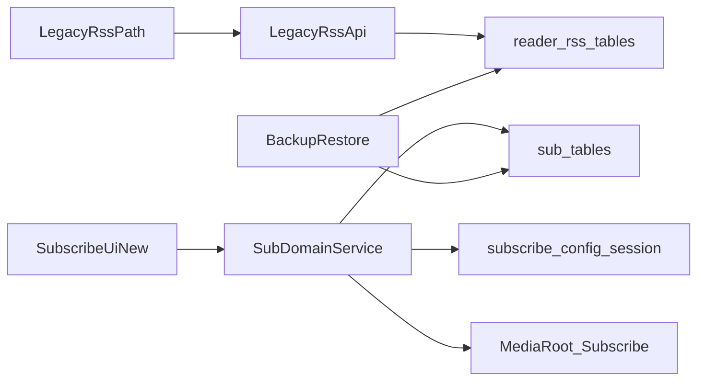

# Folo-dev 迁移为 Reader 订阅模块计划

## 目标与边界

- 在 Reader 内落地完整订阅模块（能力尽量覆盖 Folo-dev 主要订阅流转），新数据仅使用 `sub_*` 体系。
- 保持 legado RSS 全链路不变：`reader_rss_*` 表、legacy Web API 路由、备份恢复项与兼容映射均不改语义。
- 不导入历史 Folo 数据：新订阅模块从空数据启动，后续可单独补导入工具。

## 现有基础复用点

- 模块注册与导航：[`d:/Projects/Rust/Reader/Reader/src/lib/modules/module-registry.ts`](d:/Projects/Rust/Reader/Reader/src/lib/modules/module-registry.ts)
- 表名前缀集中治理：[`d:/Projects/Rust/Reader/Reader/src/lib/database/table-names.ts`](d:/Projects/Rust/Reader/Reader/src/lib/database/table-names.ts)
- 分模块 schema 版本：[`d:/Projects/Rust/Reader/Reader/src/lib/database/core/schema-modules.ts`](d:/Projects/Rust/Reader/Reader/src/lib/database/core/schema-modules.ts)
- 迁移流水线：[`d:/Projects/Rust/Reader/Reader/src/lib/database/migrations.ts`](d:/Projects/Rust/Reader/Reader/src/lib/database/migrations.ts)
- 订阅壳页与会话域：[`d:/Projects/Rust/Reader/Reader/src/pages/media/subscribe/SubscribePage.tsx`](d:/Projects/Rust/Reader/Reader/src/pages/media/subscribe/SubscribePage.tsx), [`d:/Projects/Rust/Reader/Reader/src/lib/persistence/domains/subscribe-session.ts`](d:/Projects/Rust/Reader/Reader/src/lib/persistence/domains/subscribe-session.ts)
- 文件根目录隔离：[`d:/Projects/Rust/Reader/Reader/src/lib/media/media-root.ts`](d:/Projects/Rust/Reader/Reader/src/lib/media/media-root.ts)

## 迁移架构（双轨并存）

## 分阶段实施

### 阶段1：固化数据边界与目录边界

- 新增并统一 `sub_*` DAO 边界层（sources/feeds/entries/search*keywords），禁止跨写 `reader_rss*\*`。
- 为订阅模块补齐独立持久化域（如 `subscribe.config`/`subscribe.session`），沿用 `*_v1` 键策略。
- 在媒体根目录体系中为订阅模块定义独立数据目录（与阅读/音乐/影视同级隔离）。

### 阶段2：迁入 Folo 核心数据流（Reader 化）

- 按 Reader 风格重建 Folo 核心服务：订阅源管理、feed 同步、entry 入库、状态更新。
- 将 Folo 的数据库服务层语义适配到 Reader 的 `sub_*` 表结构与事务习惯。
- 保持刷新/抓取逻辑可观测（日志与错误语义与现有模块一致）。

### 阶段3：替换订阅页面能力

- 将 [`SubscribePage.tsx`](d:/Projects/Rust/Reader/Reader/src/pages/media/subscribe/SubscribePage.tsx) 从占位页升级为真实订阅工作台。
- 接入 source/feed/entry 列表、刷新、启停、排序等核心交互（覆盖 Folo 主能力）。
- 会话态（当前 tab、筛选、排序）仅写订阅域，不共享阅读/音乐/影视键空间。

### 阶段4：API 与备份恢复扩展（不破坏 legacy）

- 新增订阅模块专用 API 路由（命名与 legacy RSS 路由完全分离）。
- 备份导出新增订阅模块独立文件名（例如 `subSources.json` 等），不改 `rssSources.json` 及其解析行为。
- 恢复流程增加“可选恢复订阅模块数据”，默认不影响 legacy RSS 恢复逻辑与优先级。

### 阶段5：回归与发布保护

- DB 回归：验证 `reader_rss_*` 在迁移前后行数/主键一致，`sub_*` 独立读写。
- API 回归：legacy RSS 路由请求/响应保持字节级兼容（关键字段与错误码）。
- 备份恢复回归：旧备份包恢复结果一致；新备份包能独立恢复订阅模块。
- UI 回归：阅读模块 RSS 页行为不变；新订阅页独立可用。

## 验收标准

- `legado` 订阅数据无变更、能力无回退、现有自动化调用无破坏。
- Reader 订阅模块具备 Folo 主流程能力，且所有数据只落 `sub_*` 与订阅目录。
- 代码结构与其它媒体模块一致：独立前缀、独立项目目录边界、独立数据目录边界。

## 风险与缓解

- 高风险：误触 legacy 表或路由语义。缓解：加入“禁止跨表写入”断言与回归测试。
- 中风险：Folo 模型与 Reader 表结构差异。缓解：先实现适配层，再逐步压平为 Reader 原生模型。
- 中风险：备份恢复串扰。缓解：新订阅备份文件全新命名，并做旧包回归测试矩阵。

## 分阶段验收用例清单（输入/预期结果）

### 阶段0：契约冻结与模型映射

- 用例0-1（legacy 表契约冻结）
  - 输入：读取并比对 `reader_rss_sources`、`reader_rss_articles`、`reader_rss_read_records`、`reader_rss_stars` 当前 schema（列名/类型/主键/索引）与冻结文档。
  - 预期结果：四张表结构与冻结文档一致；无新增/删除/重命名列；主键与关键索引一致。
- 用例0-2（legacy API 契约冻结）
  - 输入：对 `/getRssSources`、`/saveRssSource`、`/refreshRssArticles` 发送基准请求并保存响应样本。
  - 预期结果：状态码、字段集合、关键错误码语义与基线一致。
- 用例0-3（Folo->sub 映射完整性）
  - 输入：用 3 组样本数据（最小字段、完整字段、异常字段）跑映射函数。
  - 预期结果：source/feed/entry 全部可映射；缺失字段按默认策略补齐；异常字段被记录且不污染 legacy 数据。

### 阶段1：sub 数据边界与目录边界

- 用例1-1（sub 表创建与隔离）
  - 输入：执行数据库初始化/迁移后检查 `sub_sources`、`sub_feeds`、`sub_entries`、`sub_search_keywords`。
  - 预期结果：表存在且结构符合设计；不存在对 `reader_rss_*` 的结构变更。
- 用例1-2（schema_modules 版本登记）
  - 输入：升级数据库版本并查询 `schema_modules` 的 `subscribe` 记录。
  - 预期结果：`subscribe` 版本正确递增；重复升级幂等；回放升级无异常。
- 用例1-3（DAO 边界防串写）
  - 输入：通过订阅模块 DAO 执行增删改查，并抓取实际 SQL 或审计日志。
  - 预期结果：仅访问 `sub_*`；无任何 `reader_rss_*` 写入语句。
- 用例1-4（持久化键空间隔离）
  - 输入：写入订阅配置与会话态，再读取音乐/阅读/影视配置键集合。
  - 预期结果：仅新增 `subscribe.*` 相关键与 `*_v1` 存储键；其他模块键值不变。
- 用例1-5（独立数据目录）
  - 输入：触发订阅模块缓存写入并检查目录树。
  - 预期结果：仅写入订阅模块目录；不写入 `Reader/Audio/Video` 目录。

### 阶段2：Folo 核心服务迁移

- 用例2-1（订阅源管理）
  - 输入：新增、更新、启停、删除订阅源各一次。
  - 预期结果：`sub_sources` 状态与操作一致；失败场景返回明确错误且不影响 legacy。
- 用例2-2（feed 同步）
  - 输入：对 2 个不同协议/格式源执行同步（成功/失败各一例）。
  - 预期结果：成功源生成或更新 `sub_feeds`；失败源记录错误并可重试；无脏写。
- 用例2-3（entry 入库与去重）
  - 输入：连续两次拉取同一 feed（第二次含重复条目）。
  - 预期结果：`sub_entries` 去重生效；只新增新条目；重复条目不重复入库。
- 用例2-4（状态更新）
  - 输入：对条目标记已读/未读、收藏/取消收藏。
  - 预期结果：状态字段按预期切换；查询视图实时反映；不影响 `reader_rss_read_records`/`reader_rss_stars`。
- 用例2-5（防误写断言）
  - 输入：模拟异常路径（例如错误 service 注入）并触发写入。
  - 预期结果：断言拦截跨域写入；日志可定位；事务回滚完整。

### 阶段3：订阅页面完整化

- 用例3-1（页面主视图）
  - 输入：打开订阅页并加载空数据与非空数据两种状态。
  - 预期结果：空态与列表态渲染正确；无占位页文案残留。
- 用例3-2（核心交互）
  - 输入：执行刷新、启停、排序、筛选、切换源与条目。
  - 预期结果：操作结果与数据层一致；交互反馈及时；失败提示可理解。
- 用例3-3（会话态持久化）
  - 输入：设置 tab/filter/sort 后重启应用或刷新页面。
  - 预期结果：订阅页会话态恢复准确；不覆盖其他模块会话态。
- 用例3-4（跨模块隔离）
  - 输入：同时在阅读 RSS 页和新订阅页进行操作。
  - 预期结果：两边数据与 UI 状态互不干扰；导航切换无状态串扰。

### 阶段4：新 API 与备份恢复扩展

- 用例4-1（新订阅 API 可用性）
  - 输入：调用新增订阅 API 的增删改查与同步接口。
  - 预期结果：请求成功率、返回结构、错误码符合新契约；与 legacy 路由无命名冲突。
- 用例4-2（legacy API 回归）
  - 输入：对 legacy RSS API 执行基线请求对比（同阶段0样本）。
  - 预期结果：字段、状态码、关键行为完全一致。
- 用例4-3（备份导出隔离）
  - 输入：执行一次完整导出并检查产物文件。
  - 预期结果：新增 `sub*` 导出文件；`rssSources.json`、`rssStar.json` 等 legacy 文件仍存在且内容语义不变。
- 用例4-4（恢复流程兼容）
  - 输入：分别导入“旧备份包（无 sub 文件）”和“新备份包（含 sub 文件）”。
  - 预期结果：旧包恢复成功且不报缺失；新包可同时恢复 legacy + sub 数据；恢复优先级符合设计。

### 阶段5：回归与发布门禁

- 用例5-1（DB 一致性快照）
  - 输入：迁移前后对 `reader_rss_*` 做行数与主键快照对比。
  - 预期结果：快照一致（允许时间戳类非关键字段差异为 0）；`sub_*` 变化仅来自新订阅操作。
- 用例5-2（端到端主流程）
  - 输入：从新增订阅源到同步、浏览、已读、收藏、重启恢复跑一遍 E2E。
  - 预期结果：流程全通；关键路径无阻断；数据可追溯。
- 用例5-3（异常与回滚）
  - 输入：注入网络失败、DB 写失败、恢复中断等异常场景。
  - 预期结果：错误可见且可恢复；事务回滚正确；legacy 链路不受牵连。
- 用例5-4（性能门槛）
  - 输入：在中等数据量（例如 100 源/1 万条 entry）执行列表加载与同步。
  - 预期结果：页面交互与同步耗时不低于现有模块可接受阈值；无明显卡顿与内存异常增长。
- 用例5-5（发布阻断条件）
  - 输入：执行发布前检查清单（回归报告、契约对比、回滚演练记录）。
  - 预期结果：所有必过项通过才允许发布；任一 legacy 破坏项失败即阻断发布。
