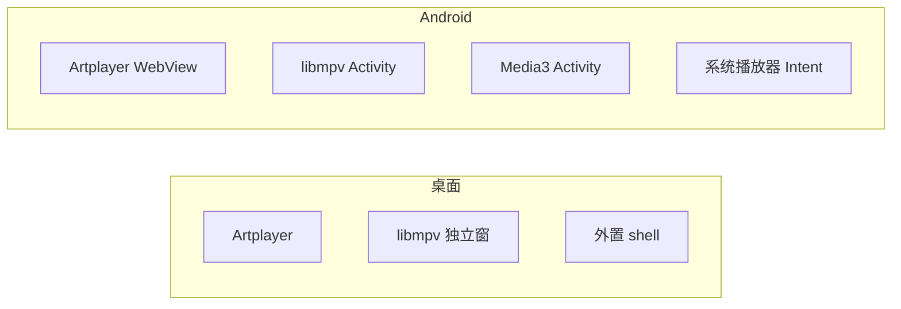
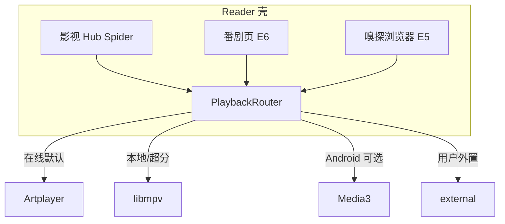

# 影视第二播放核与体验补齐规划（已定稿）

## 已确认边界

来自 [bugs.txt](d:\Projects\Reader\docs\bugs.txt) L31–33 + **Q1–Q15 用户回复**：

- **主路**：Hub 流媒体继续 Artplayer + MSE。
- **桌面增强**：进程内 **libmpv + 独立播放窗**（原生 VO 优先，非主壳挖洞）；**捆绑**预编译 lib。
- **Android 增强**：**libmpv Activity** + **Media3 可选核**（用户可切换）；协议在桌面 E2 冻结后再实现。
- **外置保留**：mpv/VLC/system shell，深度交接（参数必须、进度尽力）；Anime4K shaders **外置+内嵌两路**。
- **新建**：内置**网页嗅探浏览器**；**独立番剧页**（Kazumi 式，与 Spider/CONFIG 隔离）。
- **延期**：应用内 BT/libtorrent；SMB/FTP（E4 之后）；AI 字幕（挂主程序 AI）；缩略图 seek（E2.1/之后）。
- **Blocked 不变**：专有 P2P so、完整 Cling DLNA、Widevine L1、主 WebView 挖洞、帧回灌 Artplayer、Cast/Syncplay。

---

## Q1–Q15 定稿

| 题 | 你的决定 | 计划落点 |
|----|----------|----------|
| Q1 Media3 | **接入** | Android 可选核；见下方「Media3 具体方案」 |
| Q2 番剧页 | **新建** | 新阶段 **E6**，独立模块 |
| Q3 B站弹幕 | 同意子集 | E3：按 av/ep 拉弹幕，无番剧客户端 |
| Q4 嗅探浏览器 | **做** | 新阶段 **E5** |
| Q5 独立窗形态 | 同意原生优先 | E2 原生 VO；Solid 播控可 E2.1 |
| Q6 分发 | 同意捆绑 | 安装包预编译 libmpv |
| Q7 GPL | 同意 + **补法律风险分析** | E0 专节/可拆 `VIDEO_LIBMPV_LICENSE.md` |
| Q8 Android 时机 | 同意桌面先 | E2 桌面 → 再 Android mpv/Media3 |
| Q9 外置 IPC | 同意 | 参数必须 / 进度尽力 |
| Q10 Anime4K | 同意两路 | E1 外置注入；E2 内嵌 UI |
| Q11 mpvRx 增值 | 同意 | HDR+Anime4K 本轮；缩略图后；AI 远期；Cast 不做 |
| Q12 wyzie | 同意 | E3 尾 |
| Q13 SMB/FTP | 同意延后 | E4 = 本地+WebDAV only |
| Q14 路由 | 同意 | 本地/WebDAV→libmpv；在线→Artplayer；可强制 |
| Q15 先文档 | 同意 | 执行时 **先 E0 再代码** |

### Media3 具体方案（Q1 定稿解释）

Media3 是 **Android 库**，桌面不引入。

- **PlaybackEngine** 枚举：`artplayer | libmpv | media3 | external`（`media3` 仅 Android 编译/运行时可见）。
- **用途**：补齐 FongMi/TVBox 侧 Exo 习惯能力（部分 HLS/DASH、轨切换、部分设备上比 WebView MSE 稳）；与 libmpv **并存可选**，对标 DanDanPlay 多内核，**不是**给 libmpv「插 Exo 解码器」。
- **默认**：Android 在线直链仍可先 Artplayer；失败或用户选「系统核」走 Media3；本地/超分走 libmpv。
- **参考**：`VideoPlayer/nextplayer-main`、`only_player-main`、FongMi 播放器设置；能力矩阵在 E0 文档列出「Exo 能力 → Media3 / libmpv / 不做」映射。
- **不做**：桌面 Media3；IJK 再引入一条。

### 独立番剧页具体方案（Q2）

- **E6**：壳内新入口（如「追番」），**独立规则模型**（XPath/Kazumi 风格），**禁止**写入 FongMi `sites[]`/Spider 契约。
- 播放复用 PlaybackRouter（Artplayer / libmpv / Media3）。
- 参考：`VideoPlayer/Kazumi-main`；文档写清与影视 Hub 的数据隔离（独立表前缀建议 `bangumi_*` 或 `anime_*`）。

### 嗅探浏览器具体方案（Q4）

- **E5**：应用内 WebView 浏览 + 视频 URL 嗅探 + 一键交 PlaybackRouter（对标小喵 `TVBrowser` / hikerView 思路）。
- 与现有 `rules`+`parse` **并存**：浏览器服务「人肉找片」；rules 服务源站自动化。

---

## 目标架构

统一抽象路径建议：`src/lib/media/video/playback/`。

---

## 25 项处置矩阵（定稿）

| 簇 | 项 | 处置 | 阶段 |
|----|----|------|------|
| 内核 | 1, 21, 25 | Artplayer + 桌面 libmpv + 外置；Android libmpv **与 Media3** | E0–E2 |
| 画质 | 2, 3, 10, 11, 18 | hwdec/HDR/Anime4K→libmpv；mpvRx 缩略图后置 | E2 |
| 轨字幕 | 4, 12, 17 | libmpv ASS；wyzie E3 尾；Artplayer 仍 `Result.sub` | E2–E3 |
| 弹幕 | 5, 6, 13, 14, 23 | 弹弹+B站子集；DFM 仅 Android | E3 |
| 本地网盘 | 7, 9, 19 | 本地库+WebDAV；SMB/FTP 更后 | E4 |
| 嗅探 | 8 | **新建**嗅探浏览器 | E5 |
| 番剧 | 16, 22 | **新建**独立番剧页 | E6 |
| UX | 12, 20 | 手势/控制栏参考 mpvKt/Ex；B站化播控 | E2–E3 |
| 不做 | BT；专有 P2P so；Cling；L1；Cast/Syncplay；帧回灌 Artplayer | MD 写明 | — |

---

## 实现分期

### E0 — 文档与协议（执行第一交付）

1. **`docs/VIDEO_PLAYBACK_KERNEL.md`**：多核选型、路由、平台表、参考仓、验收。
2. **`docs/VIDEO_LIBMPV_LICENSE.md`（或内核文档专章）——法律风险分析**（用户明确要求）：
   - libmpv/FFmpeg/GPL-2/GPL-3 与 Reader 当前许可的张力
   - 动态链接 vs 静态链接常见观点与风险（非律师意见，需标注）
   - 发行义务（源码提供、安装包声明、feature-flag 关闭路径）
   - Media3（Apache 2.0）与 GPL 核并存时的注意点
   - 建议的工程缓解：可选 feature、文档披露、依赖清单
3. 修订 [`VIDEO_CAPABILITY_ROADMAP.md`](d:\Projects\Reader\docs\VIDEO_CAPABILITY_ROADMAP.md) 项 8 + 阶段 E0–E6；更新 [`docs/README.md`](d:\Projects\Reader\docs\README.md)。
4. PlaybackEngine / IPC 契约草稿（可与内核文档合并）。

### E1 — 外置深度交接

- 改 [`external-player.ts`](d:\Projects\Reader\src\lib\media\tv\play\external-player.ts)：字幕/音轨/`--input-ipc-server`/glsl-shaders。
- 进度 IPC 尽力；失败降级。
- 不做主壳 `--wid`。

### E2 — libmpv 桌面窗 → Android mpv → Android Media3

1. 桌面：捆绑 lib、独立窗、原生 VO、Anime4K Mode/Quality、音轨/ASS、HDR 基础、进度写 `video_play_record`。
2. Android：libmpv Activity，对齐同一协议。
3. Android：**Media3 可选核**（设置切换；能力映射表落地）。

### E3 — 弹幕与字幕搜索

- 弹弹play 匹配；B 站弹幕下载子集；Android DFM；wyzie 尾部。

### E4 — 本地库 + WebDAV

- 扫描/历史；WebDAV 直连播走 libmpv（复用音乐域 WebDAV 模式）。
- SMB/FTP 不进本阶段。

### E5 — 嗅探浏览器

- 内置 WebView + 嗅探 + 交 Router；文档对标小喵/hikerView。

### E6 — 独立番剧页

- Kazumi 式规则与 UI 入口；数据与 Spider Hub 隔离；播放走 Router。

---

## 文档产出节奏

| 时机 | 文档 |
|------|------|
| E0 | `VIDEO_PLAYBACK_KERNEL.md` + **法律风险分析** + 路线图/README |
| E1 | 外置 IPC 参数表与验收 |
| E2 | 窗生命周期、Anime4K、Media3 映射表、打包说明 |
| E3 | 弹弹/B站边界与密钥 |
| E4 | 本地库 schema、WebDAV 影视路径 |
| E5 | 嗅探浏览器行为与安全（JS 注入边界） |
| E6 | 番剧规则模型 vs CONFIG 对照（禁止混用） |

---

## 建议执行顺序

1. E0 文档（含法律风险分析）— 可评审后再写代码  
2. E1 外置交接  
3. E2 桌面 libmpv → Android libmpv → Android Media3  
4. E3 弹幕/wyzie  
5. E4 本地+WebDAV  
6. E5 嗅探浏览器  
7. E6 独立番剧页  

## 风险摘要

- **GPL（E0 专章）**：内嵌 libmpv 的传染与发行义务；feature-flag 缓解但不能替代合规判断。  
- Media3 + libmpv 双核：包体与维护面上升；需清晰默认与失败回退。  
- 番剧页与 Spider 双模型：产品/支持成本；必须文档隔离。  
- 嗅探浏览器：安全与滥用面；需权限与声明。  
- GPU-next ↔ Anime4K 互斥；外置 IPC 版本碎片。  
