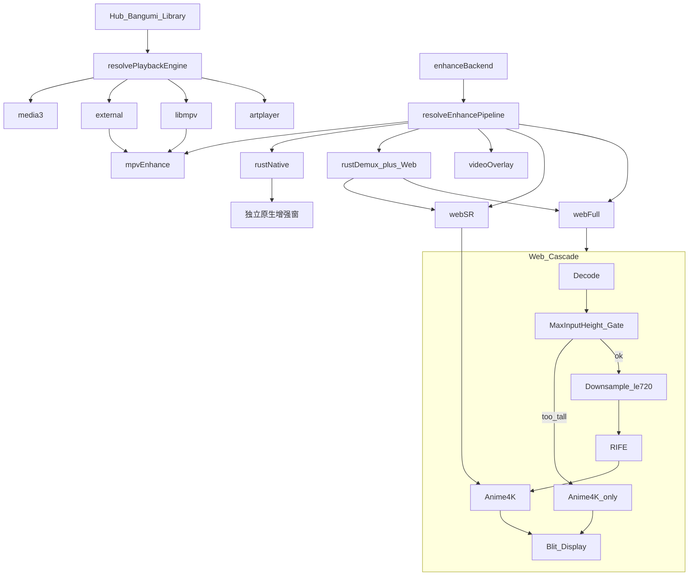

# 四路并存：纯 Web / Rust Demux / Rust Native / MpvEnhance

> **状态：三轮放行，开工中。** 二轮 8 条已闭合；下方「实现期 checklist」为非阻塞备注，写入 `VIDEO_WEB_ENHANCE.md`。

## 定稿决策

- **关系**：四路并存。现有 libmpv/外置 mpv 的 GLSL+VapourSynth 增强核不动；新增 Web / RustDemux / RustNative。
- **交付策略**：内部验收门禁 A→B→C 串行合入；**门禁 C（rust-native）为唯一可砍项**。
- **Web 默认策略**：首发 **显式 opt-in**（`enhanceBackend: 'web'`），**不进 auto 默认**；benchmark 达标后再提升 auto 优先级。
- **首发片源**：本地文件 + 已缓存 `video.bin` 直链 MP4 必须可播；mkv / 复杂容器经 rust-demux；无 WebCodecs 时 L2 仅超分。
- **HLS 范围（有意排除）**：**HLS/m3u8 不进 rust-demux / WebCodecs 增强 demux 范围**，继续走 Artplayer + hls.js 主路（可叠加 L2 超分 overlay，若 caps 允许）。避免后人当成遗漏。
- **呈现**：Web 路 canvas 占满原播放区；Rust Native **独立窗**，不挖主壳。
- **增强链**：Web/Native 下 RIFE→Anime4K **级联**；mpv 路保持现有互斥。
- **lite 资源**：允许 web opt-in（含 L0）时，**RIFE onnx + ORT wasm 随包装入**（约 5–10MB），不走首次懒下载（lite 常离线）。
- **文档**：修订 KERNEL / ANIME4K_GAP「不做 WebGPU/Canvas」为路径分流表述。

## 目标拓扑



| Pipeline | 依赖 | 超分 | 补帧 | 呈现 |
|----------|------|------|------|------|
| `web-full` | WebCodecs + WebGPU + ORT-WebGPU（真实推理探测） | Anime4K WGSL | RIFE ONNX FP16（级联前级） | canvas in-pane |
| `web-sr` | WebCodecs + WebGL2 | Anime4K GLSL ES | 关 | canvas |
| `video-overlay` | 隐藏 `<video>` 持续播 + rVFC + WebGL | 仅超分 | 不可能 | canvas 为唯一可见面（恒定落后约 1 帧） |
| `rust-demux` | Rust demux HTTP + web-full/web-sr | 同 Web | 同 Web | canvas |
| `rust-native` | wgpu + ort；**v1 软解上传 ≤1080p** | 原生 Anime4K/ORT | 原生 RIFE | 独立窗 |
| `mpv`（现有） | libmpv / 外置 mpv | GLSL | VapourSynth | 独立 VO 窗 |

## 内部验收门禁（写死，非仅提交序）

| 门禁 | 覆盖 todo | 可独立上线 | 说明 |
|------|-----------|------------|------|
| **A** | adr + **web-skeleton-core** + **web-skeleton-chrome** + anime4k-web + rife-web | **是（约 70% 用户价值）** | core 为地基中间检查点；chrome 可晚一周跟上但仍属门禁 A |
| **B** | rust-demux | 依赖 A | 容器扩展；不改渲染器 |
| **C** | rust-native | **可砍** | v1 软解≤1080p；互通另开 spike |

合入规则：未过门禁 A 验收矩阵，不得合入 B/C。**core 子验收**（纯直通 100 次 seek）通过前，不开始 anime4k/rife 合入。门禁 C 超期 → defer，系列仍可发布 A+B。

## 协议与偏好扩展

- [`types.ts`](src/lib/media/video/playback/types.ts) — 新增 `EnhancePipelineId`；**不**并入 `PlaybackEngineId`。
- [`prefs.ts`](src/lib/media/video/playback/prefs.ts) — 新增：
  - `enhanceBackend: 'auto' | 'mpv' | 'web' | 'rust-demux' | 'rust-native'`
  - 默认：`auto` **不**选 web（mkv 例外见路由）；用户显式选择后**持久化**
  - `webEnhanceEnabled` 总开关；与 `enhanceBackend='web'` **冲突时前者优先**（关闭则不进 Web 增强）
  - `frameInterpMaxInputFps`（已有语义保留）
  - **`frameInterpMaxInputHeight`**（默认如 `1080`）：源高度超过则**只走 SR、不插值**，避免 4K→720→RIFE→4K 画质劣化
- 新目录：`src/lib/media/video/enhance/`（caps、router、MediaClock、web 管线、demux client、native bridge）。
- `createWebEnhanceEngine()` / `createNativeEnhanceEngine()` 实现冻结的 `PlaybackEngine` 接口。

## 能力探测与路由（两层 caps）

### 全局 caps（启动缓存）

```ts
{
  webCodecs, webgpu, webgl2, importExternalImage,
  ortWebgpu, // 必须：最小 session 跑 1×1 张量真实推理（~50ms）
  rustDemux, rustNative, mpv
}
```

### Per-track 门禁（开流前）

对**视频与音频**分别调用 `VideoDecoder.isConfigSupported` / `AudioDecoder.isConfigSupported`（AC3/E-AC3 等常不在 Chrome 注册表）。仅探视频会导致「视频正常、音频开流即失败」。任一侧失败则降级 pipeline 或回落 Artplayer/mpv。禁止「全局 L0 → configure 即崩」。

### `resolveEnhancePipeline`（auto）

1. 用户强制 backend → 对应 pipeline（不可用则降级 + toast）
2. 若 prefs 已持久化为 `mpv` 且 mpv 可用 → MpvEnhance
3. **容器需 demux（mkv 等）且 `caps.rustDemux`**：auto **直接允许 L3**（WebView 无法播 mkv，这是唯一可播路径，不是画质选择）；首次触发 toast 说明；**若 mpv 可用则优先 mpv**
4. **auto 默认不选 web-full**；仅当用户显式 `web` 且 caps+per-track 通过 → L0/L1/L2
5. 显式 `rust-native` 且可用 → L4
6. 否则 → 纯 Artplayer（HLS/普通 MP4 主路）

接入点：[`TvSettingsPane.tsx`](src/components/media/viewer/video/tv/panes/TvSettingsPane.tsx)、[`TvVodPlayControls.tsx`](src/components/media/viewer/video/tv/panes/TvVodPlayControls.tsx)、`WebEnhancePanel` / `NativeEnhancePanel`。

---

## 播放器状态子系统

骨架拆为两 todo：

| Todo | 范围 | 子验收 |
|------|------|--------|
| **web-skeleton-core** | MediaClock / seek / rate / 音频采样 / 错误恢复 / 后台 / 热切换 / epoch；直通 canvas | 纯直通下 100 次随机 seek，每次 AV 重同步 &lt; 80ms |
| **web-skeleton-chrome** | HUD / 弹幕 / 截图 / 进度预览；ASS 砍 | 弹幕 seek/倍速不漂移；截图非空白 |

### MediaClock

- `anchor(mediaTime, ctxTime)`：play / resume / seek / rate 后必调
- `mediaTimeNow()`：锚点 + `(ctxNow - ctxAnchor) * rate`
- pause 冻结；resume 重锚

### Seek

1. 取消 in-flight fetch（`AbortController`）；scrub 节流 ~150ms
2. **`epoch++`**（管线世代）；清空呈现/解码队列；所有 `VideoFrame.close()`
3. `decoder.flush()`；mp4box `file.seek(t, true)`；rust-demux `from_pts=`（见路 B）
4. 关键帧解码 + **pre-roll 丢弃**至目标 PTS；`MediaClock.anchor`；音频按累计采样重排
5. **过期推理世代守卫**：在飞的 ORT/RIFE **无法 abort**；回调落队前校验 `epoch`，不匹配则丢弃并 `close()`，禁止幽灵帧

### 倍速

- v1：`AudioBufferSourceNode.playbackRate`（接受变调）；时钟锚同步 `rate`

### 音频精度

- 按累计采样数调度入队；处理 AAC priming / edit list

### 字幕 / 弹幕 / HUD（v1）

| 能力 | v1 |
|------|-----|
| 弹幕 | **跟**：自绘 canvas；调度器读 **`MediaClock.mediaTimeNow()`**；seek/rate 变更随时钟重锚（禁止读墙钟） |
| ASS | **砍**；提示用 mpv 增强核 |
| 截图 | **跟**：WebGPU 路径用 **`canvas.convertToBlob()`**（须在呈现帧同一任务内）；WebGL2 路径用 `preserveDrawingBuffer` + `toBlob`。禁止 WebGPU 上裸 `toBlob`（空白图） |
| 进度预览 | **跟**：SpriteStore / LocalSeekThumbOverlay 思路 |
| HUD | play/pause、seek、倍速、音量、上下集、退出增强 |

### HDR / 10bit

- tone-mapping pass 或降级到 Artplayer/mpv；禁止 P010 直出 SDR canvas

### 错误恢复 + 性能看门狗

**错误驱动：**

- 解码失败：重配置 → 降级 pipeline → toast
- ORT OOM / 推理失败：关补帧、保留超分、toast
- `webgpucontextlost`：重建或降 L1/L2

**性能驱动（与 benchmark 帧预算互引）：**

- 运行时看门狗：连续 N 帧呈现延迟 / 呈现队列饥饿 → **降 Anime4K Mode** → 仍不够 → **关 RIFE** → toast 告知
- 阈值来自 benchmark 页分阶段 ms（解码 / SR / RIFE / 呈现 × 调用频率）

### 引擎热切换

- Artplayer ↔ WebEnhance：带 `startSec` / 播放态 / 音量迁移

### 后台节流

- hidden / 最小化：暂停解码泵与 rAF；恢复时重锚

---

## 路 A：纯 Web 管线

### A1. core + chrome（门禁 A）

- Demux：`mp4box.js`（MP4/fMP4）；**不含 HLS**
- **Range 前置验证**（core 第一周必做）：`file.seek` 依赖 ranged fetch；确认 `convertFileSrc`（asset protocol）与 `video.bin` / tv_proxy 均回 **206**，否则 seek 退化为全量缓冲，100 次 seek 子验收会误挂
- WebCodecs + AudioContext + MediaClock + epoch
- 宿主：`TvWebEnhancePane`

### A2. Anime4K（门禁 A）

- 复用 [`anime4k.ts`](src/lib/media/video/playback/anime4k.ts) Mode/Quality
- shaders → WGSL / GLSL ES 3.0；看门狗可降 Mode

### A3. RIFE 级联（门禁 A）

```
解码帧
  → 若 codedHeight > frameInterpMaxInputHeight：跳过 RIFE，进入 a4kOnly
  → 否则：降采样最长边≤720 → RIFE（带 epoch）→ Anime4K → blit

a4kOnly / 源分辨率 ≥ 显示分辨率（如 4K→4K）：
  → restore-only（仅 Restore CNN）或直接关 SR，禁止跑完整 Upscale 链
  （完整链在 4K 上单帧可能 10ms+，拖垮帧率；闸门挡 RIFE 不够，须同时挡满链）
```

- 模型：`resources/rife/web/`；**lite 随包** ORT wasm + onnx
- 另受 `frameInterpMaxInputFps`、屏刷新、VFR PTS 约束；动态 t
- mpv 路互斥不变；Web 允许超分+补帧同时开

### A4. L2 机制（写死）

- `<video>` 隐藏但持续播放；canvas 唯一可见面；rVFC → WebGL 超分；恒定落后约 1 帧；补帧关

---

## 路 B：Rust 拆封装（门禁 B）

- Feature：`video-demux`；模块 `video_demux.rs`
- HTTP：
  - `POST /demux/open` → session + 已转换 extradata
  - `GET /demux/{id}/video?from_pts=` → 长度前缀帧流；**snap 前一关键帧**；回传实际起始 PTS
  - `GET /demux/{id}/audio?from_pts=` → **同样需要 from_pts 语义**：音频无关键帧，服务端**精确裁剪到目标时间戳**（协议写明），避免 seek 后音画起点错位
- CodecPrivate → avcC/hvcC；Annex-B 转换；背压；会话 GC
- **不覆盖 HLS**

---

## 路 C：Rust 纯原生增强（门禁 C，可砍）

- v1：**仅软解上传 ≤1080p**；hwaccel↔wgpu 另开 spike
- 独立窗；级联同 Web；超期 defer

---

## 与现有 mpv 路的边界

- mpv 实现与互斥 **不删不改**
- prefs 共用；Web 级联 / mpv 互斥
- lite：隐藏 mpv/native；web opt-in + **随包** ORT/onnx；enhanced 全开

## 文档修订（与代码同批）

[`docs/VIDEO_WEB_ENHANCE.md`](docs/VIDEO_WEB_ENHANCE.md) 须包含：架构、门禁、MediaClock/seek/**epoch**、L2、级联+**MaxInputHeight**、**a4kOnly/restore-only**、**性能看门狗**、mkv auto L3、HLS 排除、lite 随包、帧预算、测试流矩阵，以及下方**实现期 checklist**。

同步修订 KERNEL / ANIME4K_GAP / RIFE / CAPABILITY_ROADMAP。

### 实现期 checklist（非阻塞，进 VIDEO_WEB_ENHANCE.md）

1. per-track 含 **AudioDecoder.isConfigSupported**（与视频同等）
2. 源 ≥ 显示分辨率 → **restore-only 或关 SR**（不只挡 RIFE）
3. skeleton-core 先验证 **asset / proxy / video.bin 的 Range 206**
4. **benchmark 页** 归 `settings-regression` 交付物（看门狗阈值）
5. `webEnhanceEnabled=false` **优先于** `enhanceBackend='web'`

## 验收标准

### 平台行

| 平台 | 期望 |
|------|------|
| Windows WebView2 | L0：1080p 超分实时；级联 720p RIFE 可跑；稳态 AV &lt; 80ms |
| macOS WKWebView | 以真实 `ortWebgpu` 为准：L0 或 L1 + toast |
| Linux WebKitGTK | L2 或 L3+L1；不承诺 L0 |

### 功能 / 压力

- **core**：纯直通 100 次 seek，每次重锚 AV &lt; 80ms
- **full**：增强开启下同样 seek 压力；无幽灵帧（epoch）
- 测试流：24 / 60 / VFR / 10-bit / 带字体 mkv / 短 GOP；另：**4K 源验证 MaxInputHeight 只 SR 不插值**
- mkv：未 opt-in web 时 auto→L3（或优先 mpv）可播，非死胡同
- 热切换 / 后台 / 长播 / ORT buffer 池监控 / mpv·lite 回归
- 看门狗：人为加压可观察到 Mode 降级 → 关 RIFE → toast

### Benchmark 页

分阶段 ms：解码 / SR / RIFE / 呈现；供看门狗阈值与调档。

## 实现顺序（门禁驱动）

1. ADR + types/prefs/caps/router（含 MaxInputHeight、mkv L3、HLS 排除、lite 随包）
2. **web-skeleton-core**（含 epoch）→ 子验收 seek
3. **web-skeleton-chrome**（弹幕时钟、截图 API 分流）
4. Anime4K + HDR + 看门狗挂钩
5. RIFE 级联 + 高度闸门 + ort 实探 + benchmark
6. **门禁 A** → 可独立发布标记
7. rust-demux（音视频 from_pts）→ **门禁 B**
8. rust-native v1 → **门禁 C（可砍）**
9. 设置页 / 三平台矩阵 / 回归
