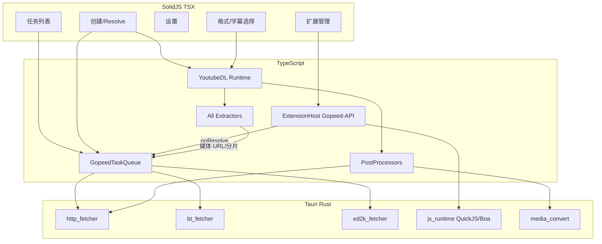

# Reader 下载模块：Gopeed + yt-dlp 全能力进程内重写

## 目标与验收

**验收（一次性落地，不做「先 HTTP/先两站」产品裁剪）**：

| 来源 | 必须达到 |
|------|----------|
| **Gopeed** | HTTP/HTTPS 多连接续传、BT/Magnet/.torrent、ED2K；任务生命周期与配置面；归档解压；Webhook；完成脚本；**扩展机制与官方扩展 API 兼容**（可安装社区扩展）；Solid 重写全部产品 UI |
| **yt-dlp** | **全站点**（对齐当前 `supportedsites.md` / ~940 extractor 模块，约 1700+ 站点条目）；格式选择/排序/合并；播放列表；cookies/鉴权；字幕；后处理全套；可嵌入的 `extract_info`/`download` 式 API |

**技术约束（沿用已定口径）**：

- 以 **TS / TSX（Solid）** 重写编排与 UI；重活与协议用 **Rust（Tauri 进程内）**。
- **禁止**侧载/spawn `gopeed`、`yt-dlp` 二进制作为引擎。
- 不把两仓源码 tree 原样 vendoring 进仓库；以 Reader 自有模块形式存在，上游仅作规范与移植源。



内部仍按依赖顺序施工，但**模块对用户可见完成态 = 上表全能力**，不设对外「精简一期」。

---

## 1. 壳模块入口

在 [`SideBar.tsx`](d:\Projects\Reader\src\components\shell\SideBar.tsx) / [`BottomBar.tsx`](d:\Projects\Reader\src\components\shell\BottomBar.tsx) 于 **subscribe 与 settings 之间**插入 `download`；同步 `PageType`、[`module-registry.ts`](d:\Projects\Reader\src\lib\modules\module-registry.ts)、[`shell-page-config.ts`](d:\Projects\Reader\src\lib\shell\shell-page-config.ts)、nav、[`App.tsx`](d:\Projects\Reader\src\app\App.tsx)、[`media-root.ts`](d:\Projects\Reader\src\lib\media\media-root.ts)、DB schema。

侧栏：任务 / 新建 / 扩展 / 设置（扩展为一级入口，对齐 Gopeed）。

---

## 2. Gopeed 全能力重写

### 2.1 Rust 协议引擎 — `src-tauri/src/download_engine/`

| 协议 | 对标 | 实现要点 |
|------|------|----------|
| HTTP/HTTPS | `internal/protocol/http` | 多连接（默认 16）、Range、work-stealing、断点、自定义 Method/Header/Body、代理、跳过证书、单任务连接数 |
| BT / Magnet / torrent | `internal/protocol/bt` | 选用成熟 Rust BT 栈（如 rqbit 系）；多文件选择、tracker、监听端口、做种策略（keep/ratio/time）、`AutoTorrent` |
| ED2K | `internal/protocol/ed2k` | ed2k 链接、端口与 server list；Rust 实现或安全 FFI 封装等价库 |

统一：`resolve` → `create` → pause/continue/delete/stats；`Emitter` 进度；`.part` 落盘；白名单目录可选。

注册：`#[tauri::command]` + [`app-commands.toml`](d:\Projects\Reader\src-tauri\permissions\app-commands.toml)。路径复用 [`media_paths.rs`](d:\Projects\Reader\src-tauri\src\media_paths.rs)。

### 2.2 TS 任务核与周边 — `src/lib/download/gopeed/`

对标 `pkg/download` + `pkg/base`：

- 状态机：`ready/waiting/running/paused/error/done`，`maxRunning` 队列
- 完整 `DownloaderStoreConfig`：downloadDir、protocolConfig（http/bt/ed2k）、proxy、webhook、script、autoTorrent、archive、autoDeleteMissingFileTasks
- 归档解压（zip/tar/7z/rar、分卷、密码、文件名编码）
- Webhook（`DOWNLOAD_DONE` / `DOWNLOAD_ERROR`）与完成脚本列表
- 持久化（SQLite，语义对齐 bbolt 任务/扩展存储）

### 2.3 扩展机制（必须兼容 Gopeed）— `src/lib/download/gopeed/extensions/` + Rust JS 运行时

对标 `extension.go` / goja engine，**社区扩展可直接用**为目标：

| 能力 | 要求 |
|------|------|
| `manifest.json` + entry | 同字段解析 |
| 事件 | `onResolve` / `onStart` / `onError` / `onDone` |
| URL match | Chrome 扩展风格规则 |
| `gopeed.*` API | info / logger / settings / storage 等与官方文档对齐 |
| 安装 | 本地目录、**git 安装/升级检查/升级** |
| settings | 声明式表单 → Solid UI |
| 开关/删除/开发模式路径 | 全套管理 UI |
| 复杂页 | WebView 宿主（Tauri webview，对标 `engine/webview`） |

JS 宿主：Rust 侧 **QuickJS 或 Boa**（进程内，对标 goja），注入 fetch/XHR polyfill；**不是** Node 子进程跑扩展。

### 2.4 UI（TSX 全量）

对标 Flutter 模块，全部自研：

- 任务（下载中/已完成）、创建（Resolve 预览、BT 文件树）、设置（各协议细项、代理、API 相关若保留、Webhook/脚本/解压）
- **扩展**管理页
- 历史/通知按 Reader 壳既有模式接入

不移植：Flutter、`gopeed:` 系统协议、浏览器 Native Messaging Host（若日后要浏览器接管，另立 Reader 扩展，不阻塞本验收）。

---

## 3. yt-dlp 全能力 / 全站点重写

上游规模（本机树）：**~940 extractor 文件**、`supportedsites.md` **~1728** 行站点条目。全量用手写不可维；采用 **兼容运行时 + 机械移植流水线**。

### 3.1 YoutubeDL 兼容运行时 — `src/lib/download/ytdlp/`

对标 `yt_dlp/YoutubeDL.py` 与 CLI→API 参数面：

- `extract_info` / `download`；`sanitize_info`；progress / postprocessor hooks
- 格式：`-f` 选择器、`-S` 排序、过滤表达式、多格式/`+` 合并、`/` 回退
- 播放列表：flat、items 范围、archive 去重、lazy、max-downloads、skip-after-errors
- Cookies：文件、浏览器导入（桌面）、headers、username/password/netrc、impersonate（TLS 指纹策略在 Rust HTTP 层落地）
- 输出：`-P`/`-o` 模板、续传、限速、并发分片数
- 特殊前缀（`:ytfav` 等）随对应 extractor 一并移植

播放与下载共用此运行时；删除 [`extractors.ts`](d:\Projects\Reader\src\lib\media\tv\play\extractors.ts) 对 `yt-dlp` CLI 的依赖。

### 3.2 全站点 extractor 移植流水线

```
yt-dlp-master/yt_dlp/extractor/*.py
        ↓  AST / 规则转换 + 人工修复队列
src/lib/download/ytdlp/extractor/**/*.ts
        ↓  registry 自动生成（对齐 _extractors）
supportedsites 对表测试
```

要求：

1. 先移植 **公共基类与 utils**（`common.py`、`youtube/…` 共享、网络/解析辅助），使运行时 API 与 Python 版调用习惯尽量同构，降低逐文件改写成本。
2. **批量转换全部 extractor**；转换失败进入修复队列直至 `supportedsites` 覆盖率为 100%（相对选定上游版本钉扎，如树内 2026.07.04）。
3. **回归 harness**：对上游 test fixture / 最小 URL 集跑 probe；CI 可分层（smoke 核心站 + 全量夜间）。
4. 上游跟进策略：钉版本 + 可重复的 re-port 脚本；不把 Python 树当运行时依赖。

### 3.3 后处理全套 — `postprocessors/` + Rust

| 能力 | 落地 |
|------|------|
| 音视频合并 / remux / recode / 抽音频 | [`media_convert`](d:\Projects\Reader\src-tauri\src\media_convert.rs) / ffmpeg 能力（进程内或已有封装，**不是** yt-dlp sidecar） |
| 字幕下载/转换/嵌入 | TS + remux |
| 缩略图 / 元数据 / 章节嵌入 | TS + Rust |
| SponsorBlock mark/remove | TS PP |
| 章节切割 / download-sections | TS + 引擎 |
| 外置 downloader 语义 | 统一走本模块 Rust HTTP（aria2 行为用自研并发分片覆盖，不侧载 aria2 除非后续单列） |

强依赖（YouTube 完整）：JS 挑战求解 — 在扩展宿主或独立 QuickJS 中跑 **yt-dlp-ejs 等价逻辑**（TS/JS 移植或嵌入官方 ejs 脚本），满足「不侧载 yt-dlp CLI」且保留站点可用性。

---

## 4. 统一门面与创建路由

`src/lib/download/service.ts`：

| 输入 | 路径 |
|------|------|
| 扩展 `onResolve` 改写后的资源 | Gopeed 队列 + 对应协议引擎 |
| 媒体站 URL（extractor 命中） | YoutubeDL → 格式 UI → 下载（Rust）→ PP |
| 直链 / magnet / ed2k / torrent | Gopeed resolve/create |
| 用户强制引擎 | UI 可选「通用下载」vs「媒体提取」 |

统一任务视图可标注来源：`gopeed` | `ytdlp` | `extension`。

Cookie：[`platform-credentials`](d:\Projects\Reader\src\lib\media\auth\platform-credentials.ts) 注入 YoutubeDL；Gopeed 任务用 Header/Cookie 配置。

---

## 5. 工程与风险（写入计划，不缩小验收）

| 风险 | 对策 |
|------|------|
| Extractor 体量巨大 | 自动化 port + 钉上游版本 + 修复队列；人力集中在 runtime/utils 与失败 case |
| BT/ED2K 许可与体积 | Rust crate 选型时评估许可证与二进制体积；写入模块文档 |
| Gopeed 原引擎 GPLv3 | 本方案为重写，不链接 gopeed 代码；扩展 API **行为兼容**，不复制 GPL 源码 |
| YouTube JS 运行时 | 独立 ejs/挑战模块，与扩展 QuickJS 可共用 |
| 与音乐下载并存 | 引擎接口稳定后，再迁 `audio-download` 底层；不阻塞全能力验收 |

---

## 6. 实施顺序（依赖序，非能力裁剪）

1. 壳 Tab + 导航骨架 + 空页面  
2. Rust HTTP 引擎 + TS 队列最小闭环（支撑后续所有落盘）  
3. BT + ED2K 引擎与创建 UI（文件树/做种/服务器配置）  
4. 解压 / Webhook / 脚本 + 设置全页  
5. 扩展宿主 + 管理 UI + 用官方样例扩展做兼容验收  
6. YoutubeDL 运行时 + utils + 转换流水线  
7. **全量 extractor 移植至覆盖率 100%** + harness  
8. 后处理全套 + ejs/挑战  
9. 统一门面、砍掉播放路径 yt-dlp CLI、文档与许可证  

---

## 明确不做

- 以 sidecar/REST/CLI 调用上游 gopeed 或 yt-dlp 冒充「已迁移」
- 对外发布「仅直链 / 仅两站」的缩水完成态
- 移植 Flutter UI、浏览器 Native Host、系统 `gopeed:` 协议（非全能力验收所必需）
- 应用内种子**播放**（bugs.txt 延期项；BT **下载**在本计划内）
